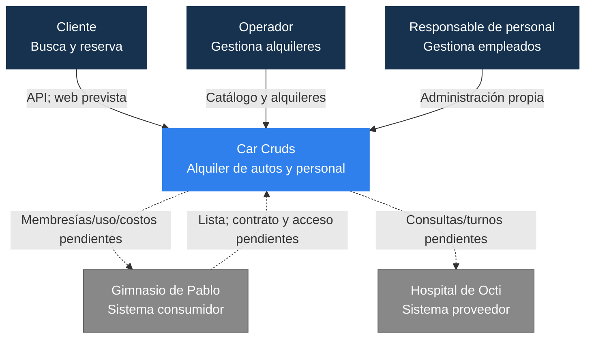
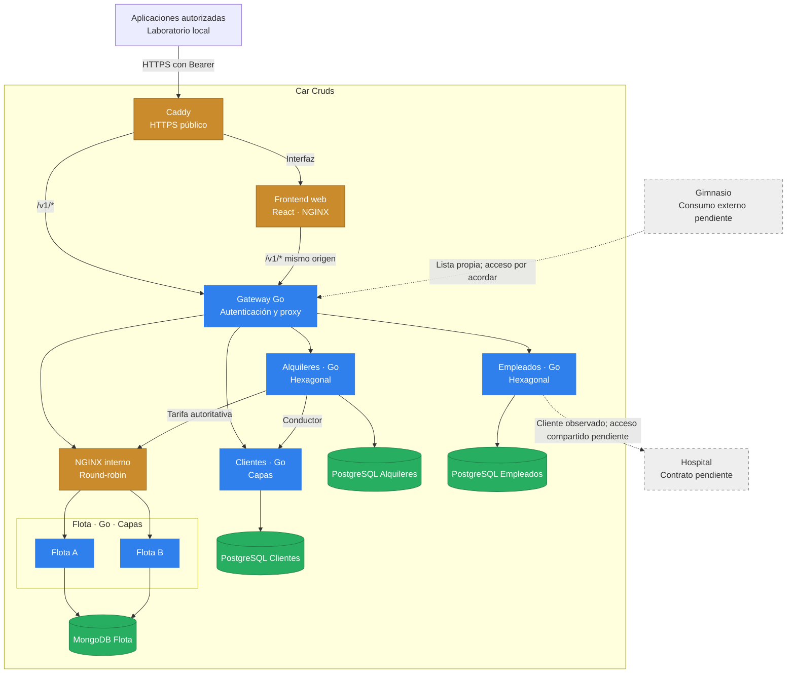
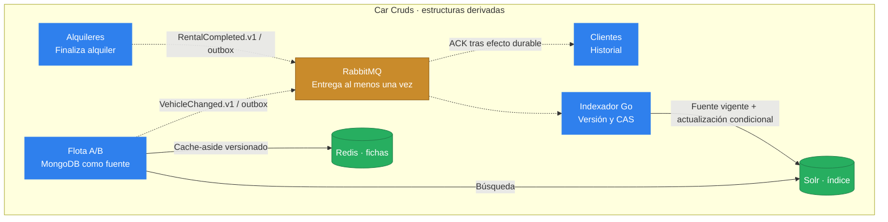

# Documento de arquitectura — Car Cruds

> **Cierre de entrega 3 — 09/11/2026:** [F3-03](PERSONAL-OPERADOR.md) agrega al panel del operador empleados, informe de membresías del gimnasio y seguimiento de turnos médicos. La entrada pública de [DESPLIEGUE](DESPLIEGUE.md) sirve ahora la interfaz por Caddy y deriva `/v1/*` al gateway; se verificó con HTTPS local, sin VM pública todavía. La revisión en navegador real, la comparación de caché y las limitaciones actualizadas se registran en [EVIDENCIA-FRONTEND](EVIDENCIA-FRONTEND.md#6-revisión-en-navegador-real--9-de-noviembre) y en la sección 9.

> **Panel del operador — 08/11/2026:** [F3-02](PANEL-OPERADOR.md) implementa gestión de flota, alta/consulta de clientes, reservas por código, retiro/devolución y mantenimiento. Acceso administrativo verificado por el gateway; pruebas locales y límites documentados.

> **Planificación de entrega 3 — 08/11/2026:** [etapas](ENTREGA-3.md) y [especificación F3-01](FRONTEND-ALQUILER.md) documentan el primer frontend del alquiler. FE-A01 a FE-A10 detallan acceso de laboratorio, búsqueda, disponibilidad, reserva idempotente y consulta/cancelación por código sobre la API vigente. F3-01 está implementado en la entrega 3 (PR #8); [evidencia y límites de verificación](EVIDENCIA-FRONTEND.md). La publicación cloud y la revisión visual en navegador siguen pendientes.

> **Verificación — 08/11/2026:** [revisión actual](REVISION-E2-2026-11-08.md) sobre `main` (`19c4e06`): suite real, contrato hospitalario aislado y traza aprobados. La CI actual falla al iniciar MongoDB. Los diagramas representan fronteras y conexiones previstas; las conexiones externas aún no acreditan operación conjunta. [PENDIENTES-E2](PENDIENTES-E2.md) distingue bloqueos externos y trabajo posterior.

**Alcance vigente — 23/10/2026:** [ADR-018](adr/ADR-018-empleados-sin-candidatos.md) sustituye D1/D3 en el alcance de personal: Empleados se limita a personal registrado, membresías y seguimiento administrativo de turnos. Los cuatro servicios y sus tecnologías se mantienen. Nuevos vínculos, intenciones y primer envío de turnos requieren empleado activo; historia y actualización de evidencia previa de inactivos continúan disponibles. Las evidencias fechadas corresponden a sus revisiones.

| Campo | Valor |
| --- | --- |
| Versión documental | 0.5 |
| Fecha | 9 de noviembre de 2026 |
| Estado | Backend, frontend de cliente/operador/personal y entrada pública preparados; VM pública y aceptación externa pendientes |
| Hito | Presentación grupal — 11 o 13 de noviembre de 2026 |
| Decisiones | D1–D13, con historial de reemplazos en [el índice ADR](adr/README.md) |

## 1. Propósito y alcance operativo

Car Cruds administra alquileres por período y tarifa. Alquileres conserva precio y agenda; retiro/devolución controlan la ocupación física. Empleados administra empleados, membresías y seguimiento administrativo de turnos. El gimnasio consumirá su lista y aportará membresías/gastos; el hospital de Octi provee Turnos para socios 1.0.0. [ADR-019](adr/ADR-019-consumo-turnos-socios.md) adapta el flujo existente a ese contrato; acuerdos operativos y aceptación conjunta siguen pendientes.

Los cuatro servicios propios, gateway, NGINX, persistencia, mensajería, índice y caché están implementados en el entorno Docker local. La lista de empleados funciona por API propia provisional; frontend, acceso público y consumo real del gimnasio no están implementados o validados. [ESTADO-IMPLEMENTACION](ESTADO-IMPLEMENTACION.md) contiene la evidencia del recorrido, pruebas, reinicio y traza.

## 2. Contexto — C4, nivel 1

**Figura 1. Contexto del sistema.** Las líneas continuas representan acceso propio disponible por API; las discontinuas representan integración externa pendiente. Una persona registrada como empleado no adquiere por ello habilitación de conductor. Los informes no infieren diagnóstico, aptitud ni contratación.

## 3. Contenedores — C4, nivel 2

**Figura 2. Servicios y fuentes operativas.** Flota A/B son réplicas del mismo servicio; hay cuatro servicios de negocio. El gateway y Alquileres utilizan el mismo balanceador. El hospital se consumirá directamente desde Empleados; no a través de frontend ni gateway propio.

En local, gateway y web se publican únicamente en loopback. En la VM, Caddy es la única entrada pública (80/443): termina HTTPS, responde 404 en `/internal/*`, envía `/v1/*` al gateway y el resto a la interfaz estática. Las llamadas internas son HTTP/JSON autenticadas. Cada base PostgreSQL tiene nombre y credenciales propios dentro del servidor local; no hay JOIN ni claves foráneas entre servicios.

**Figura 3. Mensajería y lecturas derivadas.** La línea discontinua indica evento interno; no significa componente pendiente en esta figura. El indexador es un componente de Flota. Gimnasio y hospital no participan de RabbitMQ porque su mecanismo no fue acordado.

### Propiedad de datos

| Servicio | Datos propios | Garantía principal |
| --- | --- | --- |
| Clientes | Perfil, licencia/estado, inbox e historial | Habilitación e historial deduplicado |
| Flota | Ficha, tarifa, versión y eventos pendientes | Documento/outbox atómicos |
| Alquileres | Agenda, reserva, precio, idempotencia y outbox | Exclusión de períodos y un alquiler activo por auto |
| Empleados | Empleados, membresías, vínculos de pacientes, intenciones y evidencia de turnos | Baja lógica, lista mínima y trazabilidad |

**Alquileres es la única autoridad sobre disponibilidad temporal.** Flota no duplica esa verdad con un booleano. Solr y Redis no autorizan el precio de confirmación. Un cambio de tarifa no modifica una reserva ya confirmada.

## 4. Arquitectura interna y tecnologías

| Servicio | Estilo implementado | Separación |
| --- | --- | --- |
| Clientes | Capas | Presentación HTTP → negocio → datos PostgreSQL |
| Flota | Capas | HTTP → servicio → repositorios MongoDB/Solr y caché |
| Alquileres | Hexagonal | Dominio/aplicación → puertos → adaptadores HTTP, PostgreSQL y mensajería |
| Empleados | Hexagonal | Dominio/aplicación → puertos → adaptadores HTTP/PostgreSQL y cliente del contrato Turnos para socios |

El núcleo hexagonal no depende de HTTP, SQL ni SDK de infraestructura. Repository, Adapter e inyección por constructores aíslan cambios y permiten unitarios con falsos. Outbox y consumidor idempotente protegen efectos derivados; cache-aside optimiza exploración. Circuit Breaker sigue previsto y no se incluye entre los mecanismos implementados.

Los ejecutables están en `cmd/` y utilizan Go 1.26.1/`net/http`. La infraestructura real se define en `compose.yaml`; imágenes fijadas por digest y credenciales generadas fuera de Git. No se propone Event Sourcing, CQRS completo ni programación reactiva sin necesidad adicional.

## 5. Reserva y consistencia

1. Gateway autentica; Alquileres autoriza el ámbito del cliente.
2. Se resuelve la clave idempotente por aplicación/operación antes de volver a validar: misma intención recupera la respuesta original, una distinta produce conflicto.
3. Se consulta conductor a Clientes y tarifa vigente a Flota por el LB, omitiendo Redis/Solr.
4. Se validan fechas, duración, licencia e importe esperado.
5. Una transacción PostgreSQL registra agenda exclusiva, reserva, precio congelado y respuesta idempotente.
6. Al devolver, otra transacción registra `COMPLETED` y `RentalCompleted` en outbox. El publicador confirma entrega antes de marcarlo publicado; Clientes registra inbox/historial antes del ACK.

La reserva no emite un evento sin consumidor definido. Los precios y la habilitación se leen antes de la transacción; esa ventana se acepta congelando la tarifa leída y revalidando conductor al retirar. No existe una transacción global entre servicios.

La revisión del 15 de octubre alinea la implementación con esa separación: lectura breve de idempotencia, validación HTTP sin retener conexión y transacción corta con segunda lectura bajo bloqueo. Solicitudes simultáneas pueden repetir lecturas externas, pero solo una respuesta por clave se confirma. La preparación cloud incorpora reinicio automático de servicios permanentes; su funcionamiento en VM y el acceso público permanecen pendientes. Ver [revisión de E2](REVISION-E2-2026-10-15.md).

[D4](adr/ADR-004-consistencia-concurrencia.md) utiliza exclusión de rangos, índice único parcial de alquiler activo y transiciones condicionales. La suite y el recorrido sobre PostgreSQL verificaron una sola ganadora concurrente, repetición y persistencia. El alquiler activo impide otro retiro aunque haya vencido su fin previsto.

## 6. Personal e integración pendiente

La lista propia activa devuelve únicamente `employeeId` y `displayName`. Conteo e ítems de una página utilizan READ ONLY REPEATABLE READ; el orden es estable. No hay instantánea entre páginas, ni debe inferirse una baja a partir de un recorrido incompleto. El gimnasio consulta la lista mínima y envía evidencia de membresías; no administra empleados ni accede a datos médicos.

Los informes externos deben distinguir afiliación, uso, gastos y evidencia faltante. El hospital deberá permitir identificar necesidad de consulta, solicitar turnos y conciliar cancelaciones/reprogramaciones. Se conservarán referencias y estados sin interpretar un timeout como “sin turno”. Tarifas, períodos, identidad y protocolos están pendientes en [INTEGRACIONES](INTEGRACIONES.md).

El flujo clínico conserva vínculo explícito con paciente, intención durable, solicitud, consulta e informe. [ADR-019](adr/ADR-019-consumo-turnos-socios.md) adapta POST/GET a `/v1` con clave privada de consumidor e idempotencia. Antes de la red se guardan contrato, clave estable igual a `requestId` y espera durable. Cada acción explícita realiza como máximo un intento HTTP; no hay reintentos automáticos. Los recuperables reutilizan clave/datos al vencer `nextAttemptAt`; 429 respeta `Retry-After`. El vínculo, la intención y cada POST que pueda crear comprueban empleado activo en la transacción local. Una baja permite consulta y `refresh` de evidencia anterior sin cancelar. Las intenciones antiguas enviadas sin procedencia idempotente jamás se reenvían; su lectura exige pertenencia verificable al consumidor. `personKind` conserva únicamente `employee`. [COMUNICACION-HOSPITAL](COMUNICACION-HOSPITAL.md) detalla incertidumbre, errores operativos e historia. La adaptación no incorpora catálogo, cancelación saliente, facturación, frontend ni despliegue.

## 7. Mensajería, índice y caché

Flota utiliza outbox embebido en el documento MongoDB, con máximo 128 pendientes: si está lleno se rechaza el cambio antes de confirmar. El indexador consulta la versión vigente y actualiza Solr condicionalmente; duplicados y mensajes atrasados no deben retroceder la proyección. Se configuraron colas y entrega durable; reproceso operativo y alertas requieren cierre.

Solr se actualiza ante cambios sin esperar búsquedas. El objetivo de frescura de 5 s desde commit sigue pendiente de medición completa. La reconstrucción inicial reencola la fuente en el mismo core y se verificó su resultado; el índice nuevo con intercambio controlado permanece previsto.

Redis utiliza TTL de 60 s en fichas y marcas de versión sin TTL. Lua impide un llenado anterior tras invalidación exitosa y mientras Redis conserva la marca. `volatile-lru` protege las marcas de expulsión; una prueba real con 69 expulsiones preservó V2 y rechazó V1. Las marcas crecen en memoria: falta una política de limpieza. Pérdida/vaciado de Redis elimina esa garantía; OOM o indisponibilidad habilitan fallback acotado. La tarifa autoritativa sigue en MongoDB. La comparación caliente/fallback registró cero lecturas de ficha MongoDB durante 8461 hits y 7395 lecturas fuente con Redis detenido. Todas las respuestas fueron 200; la latencia no mejoró uniformemente. [D7](adr/ADR-007-cache.md) conserva método, números y pendientes de fase fría/línea base deshabilitada.

## 8. Balanceo, resiliencia y observabilidad

NGINX distribuye a dos réplicas con detección pasiva. Los tiempos e intentos están en [D12](adr/ADR-012-balanceo-carga.md); el límite de lectura del proxy mide inactividad, no un deadline total. Alquileres limita las validaciones internas de confirmación a 1 s por llamada y conserva el presupuesto propio. Dos réplicas no eliminan los puntos únicos de gateway, LB y fuentes.

Se implementaron deadlines, bulkheads, pools, fallback, outbox y un circuit breaker en la caché de Flota (cinco fallas consecutivas lo abren por 2 s; después pasa una sola sonda). Solr caído afecta búsqueda; Redis caído permite lectura fuente; broker detenido conserva pendientes. Los ensayos completos y sus límites se registran en [D10](adr/ADR-010-resiliencia.md). Los proveedores externos no se ensayaron.

Logs JSON y trazas HTTP propagan request ID, identidad de instancia y contexto. Jaeger exportó una traza de reserva con siete spans en cuatro servicios. Las métricas tienen rutas estables y exposición interna. La superposición de observabilidad agrega Prometheus (recolección cada 5 s y cinco reglas de alerta) y un tablero de Grafana; el contexto de traza por AMQP sigue pendiente. [D11](adr/ADR-011-observabilidad.md) diferencia instrumentación de operación.

[D13](adr/ADR-013-capacidad-costos.md) registra la primera carga de disponibilidad, el límite de admisión de gateway, una alternativa y estimación de laboratorio cloud. No extrapola el entorno local de 12 CPU a las VM propuestas.

## 9. Limitaciones conocidas y deuda técnica aceptada

Actualizado el 9 de noviembre de 2026 para la presentación grupal. Cada fila indica si es una limitación externa, una deuda aceptada conscientemente o un pendiente de operación.

| Tema | Situación actual | Tipo | Mitigación o próximo paso |
| --- | --- | --- | --- |
| Publicación cloud | Caddy, interfaz y script de VM verificados con HTTPS local; no hay VM ni URL pública | Pendiente de infraestructura | Ejecutar [deploy-vm.sh](../scripts/deploy-vm.sh) en la VM de D13 y `checkshared` desde fuera |
| Gimnasio | Lista propia, recepción de evidencia e informe implementados; sin consumo real ni contrato aceptado | Externa | Entregar URL y token del gimnasio por canal privado; registrar su consumo |
| Hospital | Conectado a la API publicada del grupo de Octi: un turno real reservado, confirmado, consultado y facturado una sola vez ([evidencia](evidence/hospital-live-2026-11-10.json)) | Resuelto | Copiar URL y clave al `.env` de la VM; falta la aceptación formal |
| Caída de Redis | Las lecturas siguen respondiendo desde MongoDB. Un circuit breaker evita esperar el deadline de 150 ms en cada lectura: con concurrencia 1 pasó de p50 155 ms a 1,6 ms ([antes](evidence/cache-comparison-2026-11-09.json), [después](evidence/cache-breaker-2026-11-09.json)) | Resuelto | La invalidación no se omite nunca; alerta `CacheFlotaSinRedis` |
| Marcas de versión en Redis | No tienen TTL y crecen con la cantidad de vehículos | Deuda aceptada | Política de limpieza; aceptable con la flota de laboratorio |
| Identidad | Tokens por aplicación (cliente, operador, gimnasio, servicio); no hay cuentas personales ni auditoría por persona | Deuda aceptada | Proveedor de identidad; la interfaz mantiene el token solo en memoria |
| Escrituras sin idempotencia | Alta de empleado, alta de mantenimiento y edición de empleado (sin versión, último escritor gana) | Deuda aceptada | La interfaz bloquea reenvíos inciertos y pide verificar antes de repetir |
| API incompleta | No hay listado general de reservas, ni edición/baja de clientes, ni consulta/cancelación de mantenimiento | Deuda aceptada | Consulta por código o ID; la interfaz no simula operaciones inexistentes |
| Puntos únicos de falla | Una VM, un gateway, un balanceador y una instancia de cada almacén | Deuda aceptada (D13) | Dos réplicas de Flota; la alta disponibilidad queda fuera del laboratorio |
| Observabilidad | Logs JSON, trazas HTTP en Jaeger, Prometheus con cinco alertas y tablero de Grafana ([compose.observability.yaml](../compose.observability.yaml), [simulacro](evidence/alert-drill-2026-11-09.json)); no hay notificación saliente ni contexto de traza por AMQP | Deuda aceptada | Canal de notificación y propagación de trazas por mensajería (D11) |
| CI y kernel | El runner `ubuntu-24.04` usa el kernel `7.0.0-1017-azure` y MongoDB 8.x se niega a iniciar en kernels 6.19 o superiores ([SERVER-121912](https://jira.mongodb.org/browse/SERVER-121912), [SERVER-136848](https://jira.mongodb.org/browse/SERVER-136848)). La CI usa MongoDB 7.0 mediante [compose.ci.yaml](../compose.ci.yaml) y volvió a pasar completa | Externa, mitigada | La CI prueba una versión mayor distinta de la de local y VM; volver a 8 cuando MongoDB corrija la detección. La VM debe usar un kernel menor que 6.19 ([DESPLIEGUE](DESPLIEGUE.md)) |
| Operación | Sin respaldos, retención de eventos ni reproceso operativo de DLQ | Pendiente | D10 y D11 |
| Evidencia | La caché se midió caliente y con Redis detenido; faltan la fase fría, la frescura de Solr desde el commit y carga sostenida | Pendiente | Ampliar en la defensa individual |

## 10. Referencias e historial

[Enunciado](../Enunciado%20TP%20Final.md), [SPEC](../SPEC.md), [BACKLOG](BACKLOG.md), [REQUERIMIENTOS](REQUERIMIENTOS.md) e [índice ADR](adr/README.md). Material en `clases.zip`: teoría 02, 03, 04, 05, 06, 07 y 08; prácticas Repository, caché, RabbitMQ, Solr y NGINX.

Los ADR-001/003/005/008 conservan su cuerpo histórico y fueron reemplazados por ADR-014/015/016/017. ADR-018 sustituye el alcance de personal de ADR-014/015 y revisa ADR-016/017/009; las decisiones técnicas restantes se conservan. Las nuevas API propias no renombran el contrato del mock.

| Versión | Fecha | Cambio |
| --- | --- | --- |
| 0.1 | 7 de octubre de 2026 | Diseño inicial de tres servicios |
| 0.2 | 10 de octubre de 2026 | Empleados, integración administrativa y balanceador |
| 0.3 | 14 de octubre de 2026 | Arquitectura del backend implementado y límites de evidencia/operación |
| 0.5 | 9 de noviembre de 2026 | Frontend completo, Caddy con interfaz y limitaciones/deuda técnica para la presentación grupal |
