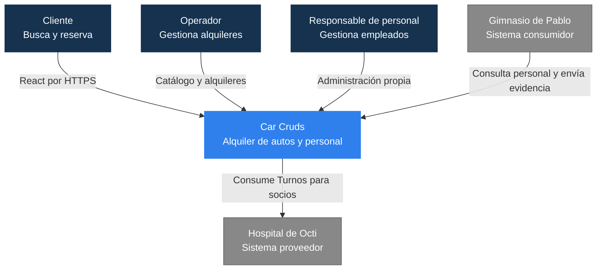
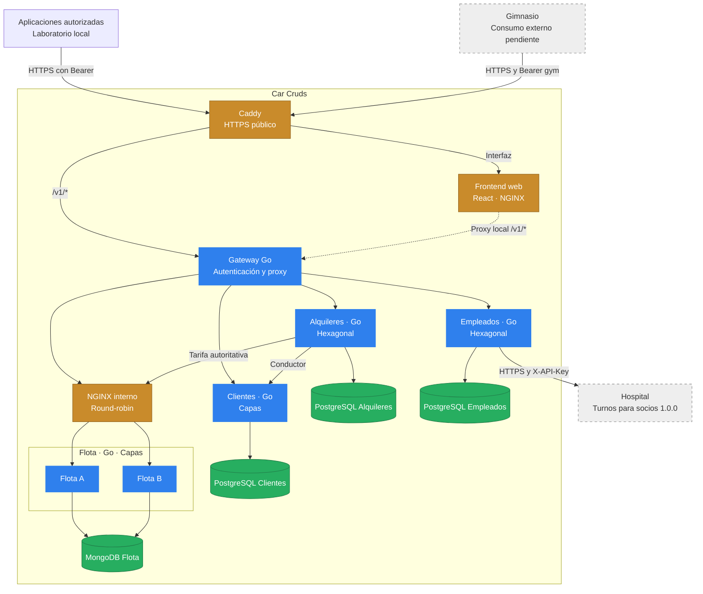
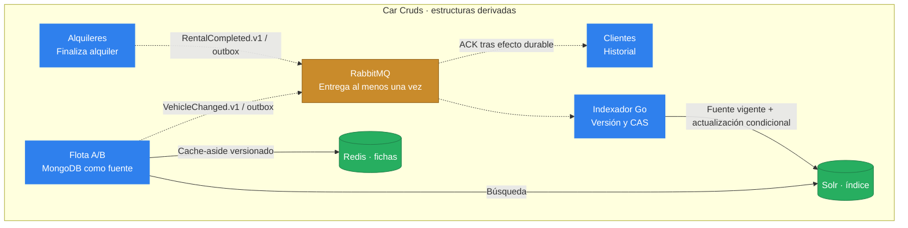
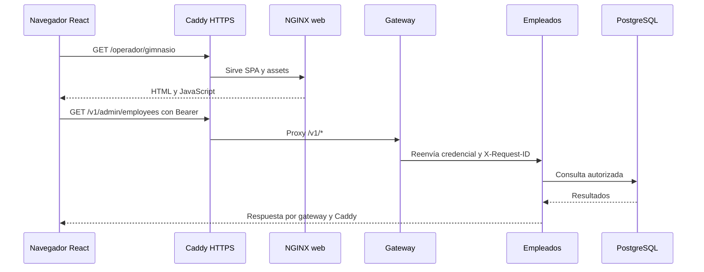
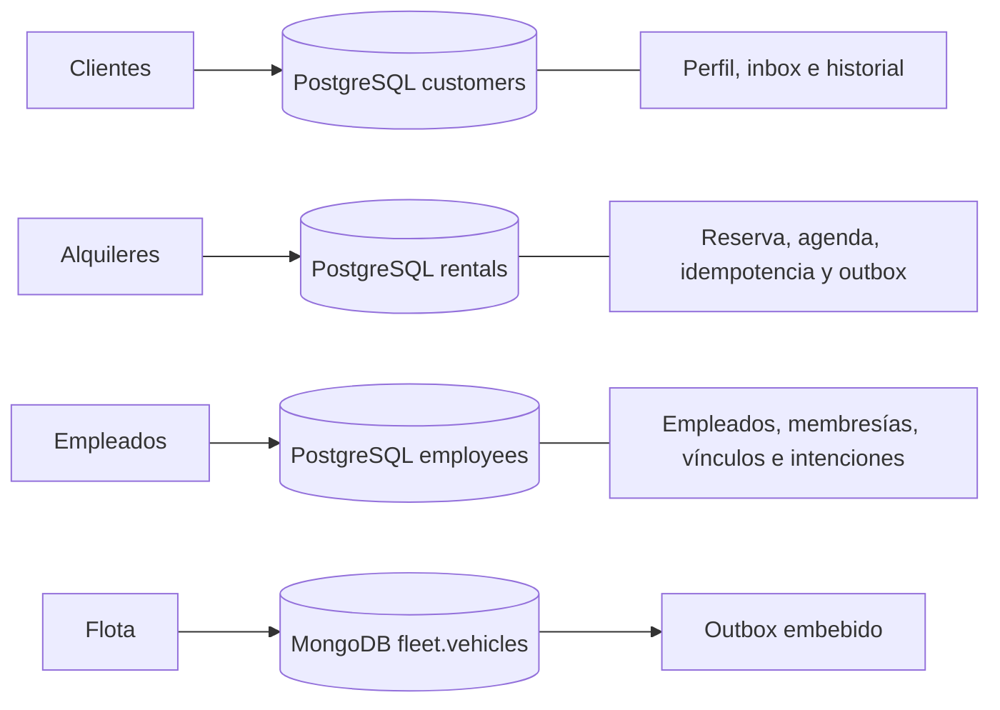

# Documento de arquitectura — Car Cruds

> **Cierre de entrega 3 — 09/11/2026:** [F3-03](PERSONAL-OPERADOR.md) agrega al panel del operador empleados, informe de membresías del gimnasio y seguimiento de turnos médicos. La entrada pública de [DESPLIEGUE](DESPLIEGUE.md) sirve ahora la interfaz por Caddy y deriva `/v1/*` al gateway; se verificó con HTTPS local, sin VM pública todavía. La revisión en navegador real, la comparación de caché y las limitaciones actualizadas se registran en [EVIDENCIA-FRONTEND](EVIDENCIA-FRONTEND.md#6-revisión-en-navegador-real--9-de-noviembre) y en la sección 9.

> **Panel del operador — 08/11/2026:** [F3-02](PANEL-OPERADOR.md) implementa gestión de flota, alta/consulta de clientes, reservas por código, retiro/devolución y mantenimiento. Acceso administrativo verificado por el gateway; pruebas locales y límites documentados.

> **Planificación de entrega 3 — 08/11/2026 (actualizada 09/11):** [etapas](ENTREGA-3.md) y [especificación F3-01](FRONTEND-ALQUILER.md) documentan el frontend del alquiler sobre la API vigente. La revisión visual en navegador se completó el 9 de noviembre; la publicación cloud sigue pendiente.

**Alcance vigente — 23/10/2026:** [ADR-018](adr/ADR-018-empleados-sin-candidatos.md) sustituye D1/D3 en el alcance de personal: Empleados se limita a personal registrado, membresías y seguimiento administrativo de turnos; las tablas, migraciones y referencias históricas se conservan sin acceso activo. Los cuatro servicios y sus tecnologías se mantienen. Nuevos vínculos, intenciones y primer envío de turnos requieren empleado activo; historia y actualización de evidencia previa de inactivos continúan disponibles. Las evidencias fechadas corresponden a sus revisiones.

| Campo | Valor |
| --- | --- |
| Versión documental | 0.5 |
| Fecha | 9 de noviembre de 2026 |
| Estado | Backend, frontend de cliente/operador/personal y entrada pública preparados; VM pública y aceptación externa pendientes |
| Hito | Presentación grupal — 11 o 13 de noviembre de 2026 |
| Decisiones | D1–D13, con historial de reemplazos en [el índice ADR](adr/README.md) |

## 1. Propósito y alcance operativo

Car Cruds administra alquileres por período y tarifa. Alquileres conserva precio y agenda; retiro/devolución controlan la ocupación física. Empleados administra empleados, membresías y seguimiento administrativo de turnos. El gimnasio consumirá su lista y aportará membresías/gastos; el hospital de Octi provee Turnos para socios 1.0.0. [ADR-019](adr/ADR-019-consumo-turnos-socios.md) adapta el flujo existente a ese contrato; acuerdos operativos y aceptación conjunta siguen pendientes.

Los cuatro servicios propios, gateway, NGINX, persistencia, mensajería, índice y caché están implementados en el entorno Docker local. La lista de empleados funciona por API propia provisional; la interfaz incluye alquiler, Personal, Hospital y Gimnasio. La verificación autenticada de Azure desde Gimnasio sigue abierta. [ESTADO-IMPLEMENTACION](ESTADO-IMPLEMENTACION.md) contiene la evidencia del recorrido, pruebas, reinicio y traza.

## 2. Contexto — C4, nivel 1

**Figura 1. Contexto del sistema.** Las flechas indican quién inicia cada interacción. El estado de aceptación se registra en la matriz de Entrega 3. Una persona registrada como empleado no adquiere por ello habilitación de conductor. Los informes no infieren diagnóstico, aptitud ni contratación.

## 3. Contenedores — C4, nivel 2

**Figura 2. Servicios y fuentes operativas.** Flota A/B son réplicas del mismo servicio; hay cuatro servicios de negocio. El gateway y Alquileres utilizan el mismo balanceador. Empleados llama al Hospital directamente desde su adaptador.

En local, gateway y web se publican únicamente en loopback. En la VM, Caddy es la única entrada pública (80/443): termina HTTPS, responde 404 en `/internal/*`, envía `/v1/*` al gateway, sirve el OpenAPI en la ruta exacta del Caddyfile y deriva la interfaz a NGINX. Las llamadas internas son HTTP/JSON autenticadas. Cada base PostgreSQL tiene nombre y credenciales propios dentro del servidor local; no hay JOIN ni claves foráneas entre servicios.

**Figura 3. Mensajería y lecturas derivadas.** La línea discontinua indica evento interno; no significa componente pendiente en esta figura. El indexador es un componente de Flota. Las integraciones externas usan HTTP. RabbitMQ distribuye eventos internos.

### Propiedad de datos

| Servicio | Datos propios | Garantía principal |
| --- | --- | --- |
| Clientes | Perfil, licencia/estado, inbox e historial | Habilitación e historial deduplicado |
| Flota | Ficha, tarifa, versión y eventos pendientes | Documento/outbox atómicos |
| Alquileres | Agenda, reserva, precio, idempotencia y outbox | Exclusión de períodos y un alquiler activo por auto |
| Empleados | Empleados, membresías, vínculos de pacientes, intenciones y evidencia de turnos | Baja lógica, lista mínima y trazabilidad |

**Alquileres es la única autoridad sobre disponibilidad temporal.** Flota no duplica esa verdad con un booleano. Solr y Redis no autorizan el precio de confirmación. Un cambio de tarifa no modifica una reserva ya confirmada.

## 4. Arquitectura interna y tecnologías

### Responsabilidades, contratos y operación

Los ejecutables en `cmd/` comparten Go y `net/http`. Las aplicaciones HTTP escuchan en 8080 dentro de Compose. El balanceador de Flota escucha en 80 dentro de la red. Los roles y códigos por operación están en [API.md](API.md). Los endpoints de diagnóstico se protegen con Bearer `admin` o `service`.

| Servicio | Operaciones y entidades | Validaciones, permisos y dependencias | Verificación |
| --- | --- | --- | --- |
| Clientes | `/v1/customers`, `/v1/customers/{id}`. Cliente, licencia, inbox e historial. | La capa de negocio valida el cliente y la licencia. El adaptador HTTP verifica rol y ámbito de cliente. PostgreSQL conserva perfiles e historial. RabbitMQ entrega el evento de devolución. | [Unitarios](../services/customers/business/service_test.go) y [persistencia e inbox](../services/customers/data/postgres_integration_test.go). |
| Flota | `/v1/vehicles`, `/v1/vehicles/search`, ficha, tarifa y reindexación. Vehículo con versión y eventos embebidos. | Escrituras de operador validan ficha, moneda, tarifa y versión. MongoDB es fuente. Redis acelera fichas. Solr permite búsqueda y RabbitMQ alimenta el indexador. Cuando falla el índice, la búsqueda informa indisponibilidad. | [Pruebas de MongoDB](../services/fleet/mongo_integration_test.go), [Solr](../services/fleet/solr_integration_test.go) y [Redis](../services/fleet/redis_eviction_integration_test.go). |
| Alquileres | `/v1/reservations`, `/v1/availability`, retiro, devolución y mantenimiento. Reserva, agenda e idempotencia. | Valida fechas, licencia, importe esperado y transiciones. Cliente limitado a sus reservas y operador a acciones autorizadas. Consulta Clientes y Flota con credencial interna. PostgreSQL excluye solapamientos y confirma devolución y outbox juntos. | [Pruebas del núcleo](../services/rentals/application/service_test.go) y [concurrencia en PostgreSQL](../services/rentals/adapters/postgres/repository_integration_test.go). |
| Empleados | `/v1/employees`, administración, membresías y `/v1/employees/clinic/*`. Empleado, fotografía mensual, vínculo e intención de turno. | Valida empleado activo para nuevas acciones clínicas, versiones de evidencia y permisos por rol. PostgreSQL es la fuente local. El adaptador usa `X-API-Key` al consultar el Hospital. Conserva incertidumbre ante respuestas técnicas. | [Contrato de Gimnasio sobre PostgreSQL](../services/employees/adapters/postgres/gym_http_test.go), [adaptador Hospital](../services/employees/adapters/clinic/client_test.go) y [contrato del proveedor](../integration/cliniccontract/contract_test.go). |

### Seguridad y diagnóstico de una solicitud

La credencial de aplicación es un Bearer opaco. El gateway autentica, aplica admisión y reenvía la solicitud. Los servicios vuelven a autenticar y limitan las operaciones por rol. Los tokens `admin`, `client`, `gym` y `service` son distintos. `gym` puede tener un vencimiento RFC3339. La clave del Hospital reside en Empleados. Las credenciales y los respaldos del entorno quedan fuera de Git. La autorización de operador es por aplicación y no identifica individualmente a cada persona. [Middleware](../internal/platform/http.go) · [Gateway](../cmd/gateway/main.go) · [Operación segura](DESPLIEGUE.md#4-credenciales)

En el despliegue de referencia Caddy reenvía la API directamente al gateway. En la variante local, NGINX web también puede derivar `/v1/*` al gateway para mantener el mismo origen del navegador. El runtime registra ruta, estado, duración, request ID y trace ID. Para comprobarlo, correlacionar el encabezado de respuesta con los logs JSON y con la traza de Jaeger. Prometheus y Grafana requieren su superposición de Compose y comprobación de operación. [ADR de observabilidad](adr/ADR-011-observabilidad.md) · [Traza de laboratorio](evidence/trace-reservation-2026-11-08.json)

### Persistencia operativa

Un servidor PostgreSQL aloja tres bases con credenciales separadas. Las relaciones y transacciones de un servicio permanecen en su propia base. Empleados conserva la evidencia vigente en `membership_evidence`, su historia en `membership_evidence_history`, el vínculo en `clinic_patient_links` y el seguimiento en `clinic_review_requests` y `clinic_appointment_history`. El Hospital conserva su propia agenda y facturación. Flota escribe vehículo y outbox en un documento de MongoDB. Redis y Solr son estructuras derivadas. Compose monta volúmenes para los datos autoritativos. Las migraciones, verificaciones de persistencia y procedimiento de respaldo están enlazados en [D3](adr/ADR-015-persistencia-v2.md) y [Despliegue](DESPLIEGUE.md#6-actualizar-la-vm-de-azure).

| Servicio | Estilo implementado | Separación |
| --- | --- | --- |
| Clientes | Capas | Presentación HTTP → negocio → datos PostgreSQL |
| Flota | Capas | HTTP → servicio → repositorios MongoDB/Solr y caché |
| Alquileres | Hexagonal | Dominio/aplicación → puertos → adaptadores HTTP, PostgreSQL y mensajería |
| Empleados | Hexagonal | Dominio/aplicación → puertos → adaptadores HTTP/PostgreSQL y cliente del contrato Turnos para socios |

El núcleo hexagonal no depende de HTTP, SQL ni SDK de infraestructura. Repository, Adapter e inyección por constructores aíslan cambios y permiten unitarios con falsos. Outbox y consumidor idempotente protegen efectos derivados; cache-aside optimiza exploración. Flota usa un circuit breaker para acotar esperas ante fallas de Redis.

Los ejecutables están en `cmd/` y utilizan Go 1.26.1/`net/http`. La infraestructura real se define en `compose.yaml`; imágenes fijadas por digest y credenciales generadas fuera de Git. No se propone Event Sourcing, CQRS completo ni programación reactiva sin necesidad adicional.

## 5. Reserva y consistencia

1. Gateway autentica; Alquileres autoriza el ámbito del cliente.
2. Se resuelve la clave idempotente por aplicación/operación antes de volver a validar: misma intención recupera la respuesta original, una distinta produce conflicto.
3. Se consulta conductor a Clientes y tarifa vigente a Flota por el LB, omitiendo Redis/Solr.
4. Se validan fechas, duración, licencia e importe esperado.
5. Una transacción PostgreSQL registra agenda exclusiva, reserva, precio congelado y respuesta idempotente.
6. Al devolver, otra transacción registra `COMPLETED` y `RentalCompleted` en outbox. El publicador confirma entrega antes de marcarlo publicado; Clientes registra inbox/historial antes del ACK.

La reserva no emite un evento sin consumidor definido. Los precios y la habilitación se leen antes de la transacción; esa ventana se acepta congelando la tarifa leída y revalidando conductor al retirar. No existe una transacción global entre servicios.

La revisión del 15 de octubre alinea la implementación con esa separación: lectura breve de idempotencia, validación HTTP sin retener conexión y transacción corta con segunda lectura bajo bloqueo. Solicitudes simultáneas pueden repetir lecturas externas, pero solo una respuesta por clave se confirma. La preparación cloud incorpora reinicio automático de servicios permanentes; su funcionamiento en VM y el acceso público permanecen pendientes. Ver [revisión de E2](REVISION-E2-2026-10-15.md).

[D4](adr/ADR-004-consistencia-concurrencia.md) utiliza exclusión de rangos, índice único parcial de alquiler activo y transiciones condicionales. La suite y el recorrido sobre PostgreSQL verificaron una sola ganadora concurrente, repetición y persistencia. El alquiler activo impide otro retiro aunque haya vencido su fin previsto.

## 6. Personal e integraciones

La lista propia activa devuelve únicamente `employeeId` y `displayName`. Conteo e ítems de una página utilizan READ ONLY REPEATABLE READ; el orden es estable. No hay instantánea entre páginas, ni debe inferirse una baja a partir de un recorrido incompleto. El gimnasio consulta la lista mínima y envía evidencia de membresías; no administra empleados ni accede a datos médicos.

Los informes externos deben distinguir afiliación, uso, gastos y evidencia faltante. El hospital deberá permitir identificar necesidad de consulta, solicitar turnos y conciliar cancelaciones/reprogramaciones. Se conservarán referencias y estados sin interpretar un timeout como “sin turno”. Tarifas, períodos, identidad y protocolos están pendientes en [INTEGRACIONES](INTEGRACIONES.md).

El flujo clínico conserva vínculo explícito con paciente, intención durable, solicitud, consulta e informe. [ADR-019](adr/ADR-019-consumo-turnos-socios.md) adapta POST/GET a `/v1` con clave privada de consumidor e idempotencia. Antes de la red se guardan contrato, clave estable igual a `requestId` y espera durable. Cada acción explícita realiza como máximo un intento HTTP; no hay reintentos automáticos. Los recuperables reutilizan clave/datos al vencer `nextAttemptAt`; 429 respeta `Retry-After`. El vínculo, la intención y cada POST que pueda crear comprueban empleado activo en la transacción local. Una baja permite consulta y `refresh` de evidencia anterior sin cancelar. Las intenciones antiguas enviadas sin procedencia idempotente jamás se reenvían; su lectura exige pertenencia verificable al consumidor. `personKind` conserva únicamente `employee`. [COMUNICACION-HOSPITAL](COMUNICACION-HOSPITAL.md) detalla incertidumbre, errores operativos e historia. La versión actual muestra catálogo y cargos consultados al Hospital. Car Cruds mantiene el seguimiento local y no ejecuta cancelaciones externas.

## 7. Mensajería, índice y caché

Flota utiliza outbox embebido en el documento MongoDB, con máximo 128 pendientes: si está lleno se rechaza el cambio antes de confirmar. El indexador consulta la versión vigente y actualiza Solr condicionalmente; duplicados y mensajes atrasados no deben retroceder la proyección. Se configuraron colas y entrega durable; reproceso operativo y alertas requieren cierre.

Solr se actualiza ante cambios sin esperar búsquedas. El [recorrido de CI](adr/ADR-006-busqueda.md#medición-de-operación-normal--9-de-noviembre-de-2026) midió alta, actualización y baja desde antes de cada escritura HTTP: las tres quedaron visibles en menos de 5 s, una cota superior del retraso desde commit en operación normal. Faltan distribuciones bajo carga y recuperación. La reconstrucción inicial reencola la fuente en el mismo core y se verificó su resultado; el índice nuevo con intercambio controlado permanece previsto.

Redis utiliza TTL de 60 s en fichas y marcas de versión sin TTL. Lua impide un llenado anterior tras invalidación exitosa y mientras Redis conserva la marca. `volatile-lru` protege las marcas de expulsión; una prueba real con 69 expulsiones preservó V2 y rechazó V1. Las marcas crecen en memoria: falta una política de limpieza. Pérdida/vaciado de Redis elimina esa garantía; OOM o indisponibilidad habilitan fallback acotado. La tarifa autoritativa sigue en MongoDB. La comparación caliente/fallback registró cero lecturas de ficha MongoDB durante 8461 hits y 7395 lecturas fuente con Redis detenido. Todas las respuestas fueron 200; la latencia no mejoró uniformemente. [D7](adr/ADR-007-cache.md) conserva método, números y pendientes de fase fría/línea base deshabilitada.

## 8. Balanceo, resiliencia y observabilidad

NGINX distribuye a dos réplicas con detección pasiva. Los tiempos e intentos están en [D12](adr/ADR-012-balanceo-carga.md); el límite de lectura del proxy mide inactividad, no un deadline total. Alquileres limita las validaciones internas de confirmación a 1 s por llamada y conserva el presupuesto propio. Dos réplicas no eliminan los puntos únicos de gateway, LB y fuentes.

Se implementaron deadlines, bulkheads, pools, fallback, outbox y un circuit breaker en la caché de Flota (cinco fallas consecutivas lo abren por 2 s; después pasa una sola sonda). Solr caído afecta búsqueda; Redis caído permite lectura fuente; broker detenido conserva pendientes. Los ensayos completos y sus límites se registran en [D10](adr/ADR-010-resiliencia.md). La prueba real histórica del Hospital y la aceptación aún pendiente de Gimnasio están documentadas en la matriz de Entrega 3.

Logs JSON y trazas HTTP propagan request ID, identidad de instancia y contexto. Jaeger exportó una traza de reserva con siete spans en cuatro servicios. Las métricas tienen rutas estables y exposición interna. La superposición de observabilidad agrega Prometheus (recolección cada 5 s y cinco reglas de alerta) y un tablero de Grafana; el contexto de traza por AMQP sigue pendiente. [D11](adr/ADR-011-observabilidad.md) diferencia instrumentación de operación.

[D13](adr/ADR-013-capacidad-costos.md) registra la primera carga de disponibilidad, el límite de admisión de gateway, una alternativa y estimación de laboratorio cloud. No extrapola el entorno local de 12 CPU a las VM propuestas.

## 9. Limitaciones conocidas y deuda técnica aceptada

Actualizado el 9 de noviembre de 2026 para la presentación grupal. Cada fila indica si es una limitación externa, una deuda aceptada conscientemente o un pendiente de operación.

| Tema | Situación actual | Tipo | Mitigación o próximo paso |
| --- | --- | --- | --- |
| Publicación cloud | Caddy, interfaz y script de VM verificados con HTTPS local; Azure responde por HTTPS; el OpenAPI público devuelve HTML | Pendiente de publicación del contrato | Verificar SHA y Caddy efectivos y ejecutar `checkshared` desde fuera |
| Gimnasio | Lista propia, recepción de evidencia e informe implementados; sin consumo real ni contrato aceptado | Externa | Entregar URL y token del gimnasio por canal privado; registrar su consumo |
| Hospital | Conectado a la API publicada del grupo de Octi: un turno real reservado, confirmado, consultado y facturado una sola vez ([evidencia](evidence/hospital-live-2026-11-10.json)) | Resuelto | Copiar URL y clave al `.env` de la VM; falta la aceptación formal |
| Caída de Redis | Las lecturas siguen respondiendo desde MongoDB. Un circuit breaker evita esperar el deadline de 150 ms en cada lectura: con concurrencia 1 pasó de p50 155 ms a 1,6 ms ([antes](evidence/cache-comparison-2026-11-09.json), [después](evidence/cache-breaker-2026-11-09.json)) | Resuelto | La invalidación no se omite nunca; alerta `CacheFlotaSinRedis` |
| Marcas de versión en Redis | No tienen TTL y crecen con la cantidad de vehículos | Deuda aceptada | Política de limpieza; aceptable con la flota de laboratorio |
| Identidad | Tokens por aplicación (cliente, operador, gimnasio, servicio); no hay cuentas personales ni auditoría por persona | Deuda aceptada | Proveedor de identidad; la interfaz mantiene el token solo en memoria |
| Escrituras sin idempotencia | Alta de empleado, alta de mantenimiento y edición de empleado (sin versión, último escritor gana) | Deuda aceptada | La interfaz bloquea reenvíos inciertos y pide verificar antes de repetir |
| API incompleta | No hay listado general de reservas, ni edición/baja de clientes, ni consulta/cancelación de mantenimiento | Deuda aceptada | Consulta por código o ID; la interfaz no simula operaciones inexistentes |
| Puntos únicos de falla | Una VM, un gateway, un balanceador y una instancia de cada almacén | Deuda aceptada (D13) | Dos réplicas de Flota; la alta disponibilidad queda fuera del laboratorio |
| Observabilidad | Logs JSON, trazas HTTP en Jaeger, Prometheus con cinco alertas y tablero de Grafana ([compose.observability.yaml](../compose.observability.yaml), [simulacro](evidence/alert-drill-2026-11-09.json)); no hay notificación saliente ni contexto de traza por AMQP | Deuda aceptada | Canal de notificación y propagación de trazas por mensajería (D11) |
| CI y kernel | El runner `ubuntu-24.04` usa el kernel `7.0.0-1017-azure` y MongoDB 8.x se niega a iniciar en kernels 6.19 o superiores ([SERVER-121912](https://jira.mongodb.org/browse/SERVER-121912), [SERVER-136848](https://jira.mongodb.org/browse/SERVER-136848)). La CI usa MongoDB 7.0 mediante [compose.ci.yaml](../compose.ci.yaml) y volvió a pasar completa | Externa, mitigada | La CI prueba una versión mayor distinta de la de local y VM; volver a 8 cuando MongoDB corrija la detección. La VM debe usar un kernel menor que 6.19 ([DESPLIEGUE](DESPLIEGUE.md)) |
| Operación | Sin respaldos, retención de eventos ni reproceso operativo de DLQ | Pendiente | D10 y D11 |
| Evidencia | La caché se midió caliente y con Redis detenido; Solr cumplió una cota de 5 s para alta, cambio y baja en CI; faltan fase fría y carga sostenida | Pendiente | Ampliar en la defensa individual |
| Revisión | Aceptación del equipo y de la cátedra; toda integración a `main` requiere aprobación del equipo mediante pull request | Pendiente | Ver [AGENTS.md](../AGENTS.md) |

## 10. Referencias e historial

[Enunciado](../Enunciado%20TP%20Final.md), [SPEC](../SPEC.md), [BACKLOG](BACKLOG.md), [REQUERIMIENTOS](REQUERIMIENTOS.md) e [índice ADR](adr/README.md). Material en `clases.zip`: teoría 02, 03, 04, 05, 06, 07 y 08; prácticas Repository, caché, RabbitMQ, Solr y NGINX.

Los ADR-001/003/005/008 conservan su cuerpo histórico y fueron reemplazados por ADR-014/015/016/017. ADR-018 sustituye el alcance de personal de ADR-014/015 y revisa ADR-016/017/009; las decisiones técnicas restantes se conservan. Las nuevas API propias no renombran el contrato del mock.

| Versión | Fecha | Cambio |
| --- | --- | --- |
| 0.1 | 7 de octubre de 2026 | Diseño inicial de tres servicios |
| 0.2 | 10 de octubre de 2026 | Empleados, integración administrativa y balanceador |
| 0.3 | 14 de octubre de 2026 | Arquitectura del backend implementado y límites de evidencia/operación |
| 0.5 | 9 de noviembre de 2026 | Frontend completo, Caddy con interfaz y limitaciones/deuda técnica para la presentación grupal |
