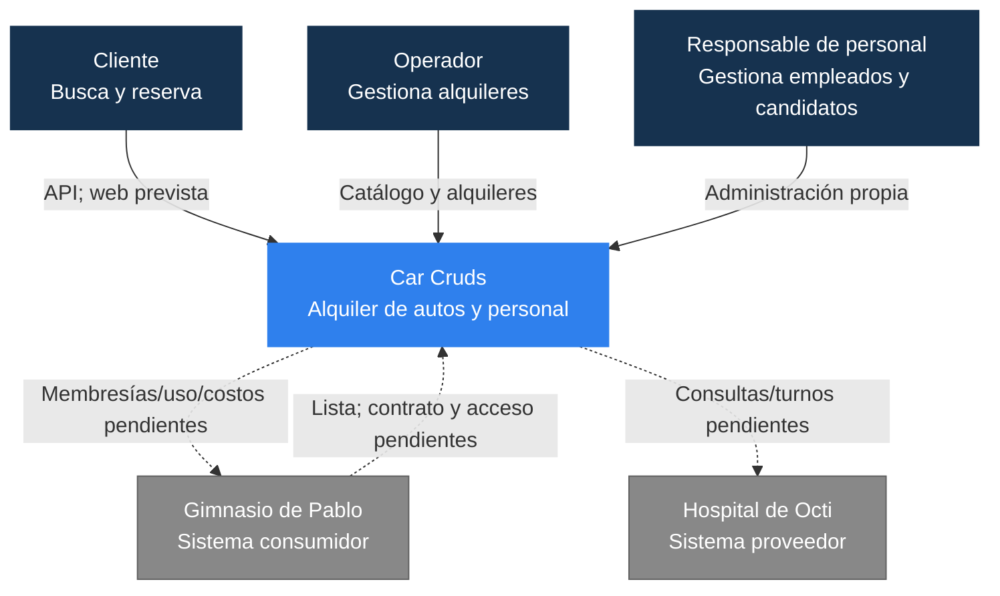
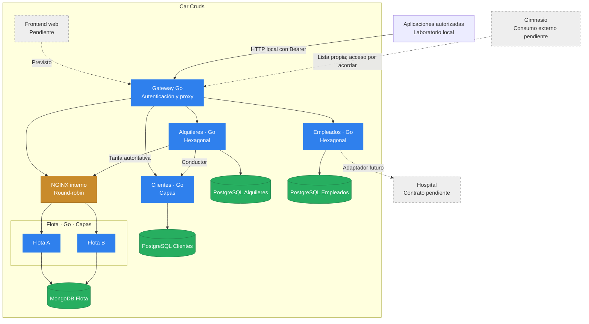
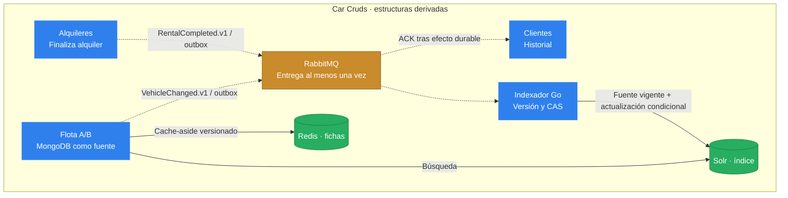

# Documento de arquitectura — Car Cruds

| Campo | Valor |
| --- | --- |
| Versión documental | 0.3 |
| Fecha | 14 de octubre de 2026 |
| Estado | Backend propio implementado; diseño externo y frontend pendientes |
| Hito | Entrega 2 — 23 de octubre de 2026 |
| Decisiones | D1–D13, con historial de reemplazos en [el índice ADR](adr/README.md) |

## 1. Propósito y alcance operativo

Car Cruds administra alquileres por período y tarifa. Alquileres conserva precio y agenda; retiro/devolución controlan la ocupación física. Empleados administra personal y candidatos separados. El gimnasio del grupo de Pablo consumirá su lista y aportará membresías/gastos; el hospital del grupo de Octi proveerá consultas y turnos. Los acuerdos y adaptadores externos siguen pendientes.

Los cuatro servicios propios, gateway, NGINX, persistencia, mensajería, índice y caché están implementados en el entorno Docker local. La lista de empleados funciona por API propia provisional; frontend, acceso público y consumo real del gimnasio no están implementados o validados. [ESTADO-IMPLEMENTACION](ESTADO-IMPLEMENTACION.md) contiene la evidencia del recorrido, pruebas, reinicio y traza.

## 2. Contexto — C4, nivel 1

**Figura 1. Contexto del sistema.** Las líneas continuas representan acceso propio disponible por API; las discontinuas representan integración externa pendiente. Una persona registrada como empleado no adquiere por ello habilitación de conductor. Los informes no infieren diagnóstico, aptitud ni contratación.

## 3. Contenedores — C4, nivel 2

**Figura 2. Servicios y fuentes operativas.** Flota A/B son réplicas del mismo servicio; hay cuatro servicios de negocio. El gateway y Alquileres utilizan el mismo balanceador. El hospital se consumirá directamente desde Empleados; no a través de frontend ni gateway propio.

La entrada Docker está publicada únicamente en loopback. Las llamadas internas son HTTP/JSON autenticadas. HTTPS público se configurará antes de publicar la capacidad. Cada base PostgreSQL tiene nombre y credenciales propios dentro del servidor local; no hay JOIN ni claves foráneas entre servicios.

**Figura 3. Mensajería y lecturas derivadas.** La línea discontinua indica evento interno; no significa componente pendiente en esta figura. El indexador es un componente de Flota. Gimnasio y hospital no participan de RabbitMQ porque su mecanismo no fue acordado.

### Propiedad de datos

| Servicio | Datos propios | Garantía principal |
| --- | --- | --- |
| Clientes | Perfil, licencia/estado, inbox e historial | Habilitación e historial deduplicado |
| Flota | Ficha, tarifa, versión y eventos pendientes | Documento/outbox atómicos |
| Alquileres | Agenda, reserva, precio, idempotencia y outbox | Exclusión de períodos y un alquiler activo por auto |
| Empleados | Empleados y candidatos | Separación, bajas y lista mínima; referencias/informes externos futuros |

**Alquileres es la única autoridad sobre disponibilidad temporal.** Flota no duplica esa verdad con un booleano. Solr y Redis no autorizan el precio de confirmación. Un cambio de tarifa no modifica una reserva ya confirmada.

## 4. Arquitectura interna y tecnologías

| Servicio | Estilo implementado | Separación |
| --- | --- | --- |
| Clientes | Capas | Presentación HTTP → negocio → datos PostgreSQL |
| Flota | Capas | HTTP → servicio → repositorios MongoDB/Solr y caché |
| Alquileres | Hexagonal | Dominio/aplicación → puertos → adaptadores HTTP, PostgreSQL y mensajería |
| Empleados | Hexagonal | Dominio/aplicación → puertos → HTTP/PostgreSQL; puertos externos sin adaptador |

El núcleo hexagonal no depende de HTTP, SQL ni SDK de infraestructura. Repository, Adapter e inyección por constructores aíslan cambios y permiten unitarios con falsos. Outbox y consumidor idempotente protegen efectos derivados; cache-aside optimiza exploración. Circuit Breaker sigue previsto y no se incluye entre los mecanismos implementados.

Los ejecutables están en `cmd/` y utilizan Go 1.26.1/`net/http`. La infraestructura real se define en `compose.yaml`; imágenes fijadas por digest y credenciales generadas fuera de Git. No se propone Event Sourcing, CQRS completo ni programación reactiva sin necesidad adicional.

## 5. Reserva y consistencia

1. Gateway autentica; Alquileres autoriza el ámbito del cliente.
2. Se resuelve la clave idempotente por aplicación/operación antes de volver a validar: misma intención recupera la respuesta original, una distinta produce conflicto.
3. Se consulta conductor a Clientes y tarifa vigente a Flota por el LB, omitiendo Redis/Solr.
4. Se validan fechas, duración, licencia e importe esperado.
5. Una transacción PostgreSQL registra agenda exclusiva, reserva, precio congelado y respuesta idempotente.
6. Al devolver, otra transacción registra `COMPLETED` y `RentalCompleted` en outbox. El publicador confirma entrega antes de marcarlo publicado; Clientes registra inbox/historial antes del ACK.

La reserva no emite un evento sin consumidor definido. Los precios y la habilitación se leen antes de la transacción; esa ventana se acepta congelando la tarifa leída y revalidando conductor al retirar. No existe una transacción global entre servicios.

La revisión del 15 de octubre alinea la implementación con esa separación: lectura breve de idempotencia, validación HTTP sin retener conexión y transacción corta con segunda lectura bajo bloqueo. Solicitudes simultáneas pueden repetir lecturas externas, pero solo una respuesta por clave se confirma. La preparación cloud incorpora reinicio automático de servicios permanentes; su funcionamiento en VM y el acceso público permanecen pendientes. Ver [revisión de E2](REVISION-E2-2026-10-15.md).

[D4](adr/ADR-004-consistencia-concurrencia.md) utiliza exclusión de rangos, índice único parcial de alquiler activo y transiciones condicionales. La suite y el recorrido sobre PostgreSQL verificaron una sola ganadora concurrente, repetición y persistencia. El alquiler activo impide otro retiro aunque haya vencido su fin previsto.

## 6. Personal e integración pendiente

La lista propia activa devuelve únicamente `employeeId` y `displayName`. Conteo e ítems de una página utilizan READ ONLY REPEATABLE READ; el orden es estable. No hay instantánea entre páginas, ni debe inferirse una baja a partir de un recorrido incompleto. Gimnasio tiene lectura y no acceso a candidatos, escrituras o datos médicos.

Los informes externos deben distinguir afiliación, uso, gastos y evidencia faltante. El hospital deberá permitir identificar necesidad de consulta, solicitar turnos y conciliar cancelaciones/reprogramaciones. Se conservarán referencias y estados sin interpretar un timeout como “sin turno”. Tarifas, períodos, identidad y protocolos están pendientes en [INTEGRACIONES](INTEGRACIONES.md).

Para una futura solicitud externa con efecto, el diseño exige intención local durable antes del envío y recuperación acordada ante resultado desconocido. Los puertos actuales no acreditan ese flujo ni el almacenamiento de turnos; la ruta administrativa informa `503 NOT_CONFIGURED`. [D9](adr/ADR-009-consumo-clinica.md) conserva el diseño.

## 7. Mensajería, índice y caché

Flota utiliza outbox embebido en el documento MongoDB, con máximo 128 pendientes: si está lleno se rechaza el cambio antes de confirmar. El indexador consulta la versión vigente y actualiza Solr condicionalmente; duplicados y mensajes atrasados no deben retroceder la proyección. Se configuraron colas y entrega durable; reproceso operativo y alertas requieren cierre.

Solr se actualiza ante cambios sin esperar búsquedas. El objetivo de frescura de 5 s desde commit sigue pendiente de medición completa. La reconstrucción inicial reencola la fuente en el mismo core y se verificó su resultado; el índice nuevo con intercambio controlado permanece previsto.

Redis utiliza TTL de 60 s en fichas y marcas de versión sin TTL. Lua impide un llenado anterior tras invalidación exitosa y mientras Redis conserva la marca. `volatile-lru` protege las marcas de expulsión; una prueba real con 69 expulsiones preservó V2 y rechazó V1. Las marcas crecen en memoria: falta una política de limpieza. Pérdida/vaciado de Redis elimina esa garantía; OOM o indisponibilidad habilitan fallback acotado. La tarifa autoritativa sigue en MongoDB. La comparación caliente/fallback registró cero lecturas de ficha MongoDB durante 8461 hits y 7395 lecturas fuente con Redis detenido. Todas las respuestas fueron 200; la latencia no mejoró uniformemente. [D7](adr/ADR-007-cache.md) conserva método, números y pendientes de fase fría/línea base deshabilitada.

## 8. Balanceo, resiliencia y observabilidad

NGINX distribuye a dos réplicas con detección pasiva. Los tiempos e intentos están en [D12](adr/ADR-012-balanceo-carga.md); el límite de lectura del proxy mide inactividad, no un deadline total. Alquileres limita las validaciones internas de confirmación a 1 s por llamada y conserva el presupuesto propio. Dos réplicas no eliminan los puntos únicos de gateway, LB y fuentes.

Se implementaron deadlines, bulkheads, pools, fallback y outbox. Solr caído afecta búsqueda; Redis caído permite lectura fuente; broker detenido conserva pendientes. Los ensayos completos y sus límites se registran en [D10](adr/ADR-010-resiliencia.md). Los proveedores externos no se ensayaron.

Logs JSON y trazas HTTP propagan request ID, identidad de instancia y contexto. Jaeger exportó una traza de reserva con siete spans en cuatro servicios. Las métricas tienen rutas estables y exposición interna; colector, tableros, alertas y contexto de traza por AMQP siguen pendientes. [D11](adr/ADR-011-observabilidad.md) diferencia instrumentación de operación.

[D13](adr/ADR-013-capacidad-costos.md) registra la primera carga de disponibilidad, el límite de admisión de gateway, una alternativa y estimación de laboratorio cloud. No extrapola el entorno local de 12 CPU a las VM propuestas.

## 9. Aspectos por resolver

| Aspecto | Pendiente |
| --- | --- |
| Capacidad compartida | Contrato aceptado, identidad/población, URL y consumo real del gimnasio |
| Integraciones | Adaptadores reales, informes de gastos/uso/turnos y pruebas contra los proveedores |
| Presentación | Frontend y acceso público HTTPS |
| Operación | Respaldos, retención de marcas/eventos, métricas/tableros/alertas y reproceso |
| Evidencia | Ampliar frescura, comparación fría/sin dependencia de caché y carga sostenida, fallas y alternativa de escala |
| Revisión | Aceptación del equipo y de cátedra; aprobación antes de integrar a main |

## 10. Referencias e historial

[Enunciado](../Enunciado%20TP%20Final.md), [SPEC](../SPEC.md), [BACKLOG](BACKLOG.md), [REQUERIMIENTOS](REQUERIMIENTOS.md) e [índice ADR](adr/README.md). Material en `clases.zip`: teoría 02, 03, 04, 05, 06, 07 y 08; prácticas Repository, caché, RabbitMQ, Solr y NGINX.

Los ADR-001/003/005/008 conservan su cuerpo histórico y están reemplazados por ADR-014/015/016/017. Las nuevas API propias no renombran el contrato del mock.

| Versión | Fecha | Cambio |
| --- | --- | --- |
| 0.1 | 7 de octubre de 2026 | Diseño inicial de tres servicios |
| 0.2 | 10 de octubre de 2026 | Empleados, integración administrativa y balanceador |
| 0.3 | 14 de octubre de 2026 | Arquitectura del backend implementado y límites de evidencia/operación |
