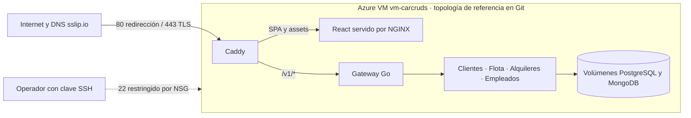

# Despliegue público

| Campo | Valor |
| --- | --- |
| Versión documental | 0.2 |
| Fecha de revisión | 9 de noviembre de 2026 |
| Estado | Configuración con interfaz web verificada con HTTPS local; VM y URL pública pendientes |
| Objetivo | Publicar la interfaz completa y la capacidad compartida, dar acceso al gimnasio durante la evaluación y acreditar la publicación cloud exigida para la presentación grupal |

## 1. Topología

Una VM Linux ejecuta el mismo `compose.yaml` del entorno local, más [compose.deploy.yaml](../compose.deploy.yaml), que agrega **Caddy** como única entrada pública:

```text
Internet ──HTTPS 443──> Caddy ─┬─ /v1/*  ──> gateway ──> Clientes / Flota (NGINX, 2 réplicas) / Alquileres / Empleados
                               └─ resto  ──> web (NGINX, interfaz estática)
```

- Caddy obtiene y renueva el certificado con Let's Encrypt para `PUBLIC_HOST` y redirige HTTP a HTTPS.
- Las rutas `/internal/*` responden 404 en Caddy. `/v1/*` llega directo al gateway, que exige el token Bearer: gimnasio y hospital usan la misma URL que antes. Cualquier otra ruta la sirve el contenedor `web` (SPA del cliente, del operador y de personal), que no publica puertos propios.
- PostgreSQL, MongoDB, Redis, RabbitMQ, Solr y Jaeger quedan ligados a `127.0.0.1` de la VM: no son accesibles desde Internet.
- Es la configuración de laboratorio de [D13](adr/ADR-013-capacidad-costos.md): una VM, sin alta disponibilidad.

## 2. Requisitos de la VM

### Inventario de Azure y alcance de la verificación

| Dato | Estado de evidencia |
| --- | --- |
| Proveedor y recurso | El registro operativo del equipo identifica una Azure Virtual Machine llamada `vm-carcruds`. |
| SO y acceso | Antecedentes de operación: Ubuntu Server 24.04 LTS, usuario `azureuser`, autenticación por clave SSH y checkout en `~/Car-Cruds`. Confirmar en la VM antes de actualizar. |
| IP y nombre público | El 11/11/2026 respondió por HTTPS `57-156-56-201.sslip.io`. El nombre codifica la IP de referencia `57.156.56.201`. |
| Capacidad y red Azure | SKU, región, arquitectura CPU, vCPU, RAM, tamaño de disco, NIC, tipo de asignación de IP y reglas NSG efectivas quedan por confirmar en Azure. Las recomendaciones de dimensionamiento de esta guía son para reproducir el entorno. |
| Revisión y servicios activos | Los GET públicos acreditan el borde y las respuestas indicadas abajo. El SHA, los archivos Compose efectivos, los volúmenes, los healthchecks y la observabilidad activa requieren acceso autorizado al host. |



### Preparación reproducible

1. Crear la VM Ubuntu 24.04 LTS, una NIC con IP pública estable y un NSG que permita TCP 80/443 desde Internet. Limitar 22 al origen de administración. Confirmar el kernel compatible indicado abajo.
2. Asociar la clave **pública** al usuario administrador. En PowerShell, conectar con `ssh azureuser@57.156.56.201`. Usar `-i` con la ruta privada propia solo si hace falta. Verificar la huella del servidor por un canal acordado.
3. Clonar en `~/Car-Cruds` y seleccionar el SHA revisado. Preparar Docker y el plugin Compose mediante el script o la instalación soportada por Ubuntu. Cargar `PUBLIC_HOST` y las credenciales en el `.env` privado. No habilitar datos demo en un entorno con datos reales sin acordarlo.
4. Ejecutar los pasos de [puesta en marcha](#3-puesta-en-marcha). Compose construye imágenes, crea la red y los volúmenes del proyecto y espera readiness. Caddy escucha 80/443, obtiene y renueva el certificado cuando DNS y red permiten la validación. El nombre `sslip.io` resuelve la IP codificada y no reemplaza el control de red ni la verificación TLS.
5. Confirmar en la VM con `git rev-parse HEAD`, `docker compose ls` y `docker compose ps`. Contrastar desde otra red con la tabla de verificación y seguir el procedimiento de actualización y rollback de la sección 6.

### Composición exacta

| Archivo | Aporte |
| --- | --- |
| [compose.yaml](../compose.yaml) | Proyecto `car-cruds`, red por defecto, gateway, cuatro servicios de dominio, dos réplicas de Flota, balanceador, indexador y dependencias. Declara volúmenes y puertos de apoyo ligados a loopback. |
| [compose.frontend.yaml](../compose.frontend.yaml) | Agrega el servicio `web` construido desde React y NGINX. El puerto de host queda en loopback para desarrollo. |
| [compose.deploy.yaml](../compose.deploy.yaml) | Agrega Caddy, sus volúmenes y el montaje de OpenAPI. Puede declarar `web` por sí mismo sin puerto de host. La receta histórica con los tres archivos conserva el puerto local si la superposición de frontend lo agrega. |

En la VM se usan los mismos `-f`, en el mismo orden, para consultar, construir, actualizar y recuperar. `docker compose ls` identifica los archivos del despliegue existente. Caddy sirve el OpenAPI en una ruta exacta, bloquea `/internal/*`, reenvía `/v1/*` al gateway y envía la interfaz a NGINX. NGINX también se usa por separado como balanceador interno de Flota. [Caddyfile](../infra/caddy/Caddyfile) · [NGINX web](../frontend/nginx.conf)

### Observación externa del 11/11/2026

| GET sin credenciales | Resultado desde fuera |
| --- | --- |
| `/`, `/operador/hospital`, `/operador/gimnasio` | HTTPS válido y 200 HTML. La respuesta acredita el acceso a la SPA. |
| `/v1/employees`, `/v1/employees/clinic/doctors` | 401 JSON. La verificación autenticada queda pendiente. |
| `/internal/ready` | 404. |
| `/contracts/employees-openapi.json` | 200 **HTML**, distinto del JSON 0.5.0 previsto en Git. Verificar configuración y SHA efectivos antes de acreditar publicación. |

- **Kernel Linux menor que 6.19.** MongoDB 8.x se niega a iniciar en kernels 6.19 o superiores por un error de TCMalloc/rseq ([SERVER-121912](https://jira.mongodb.org/browse/SERVER-121912)). La excepción para 7.0.14+ no se aplica en Ubuntu, porque `uname -r` informa `7.0.0` ([SERVER-136848](https://jira.mongodb.org/browse/SERVER-136848), abierto). Usar Ubuntu 24.04 con su kernel estándar 6.8, sin HWE, y no Ubuntu 26.04. Comprobar con `uname -r` antes de desplegar.
- Ubuntu 24.04, **8 GB de memoria** y 2 vCPU como mínimo. Lightsail figura en D13 como una estimación de laboratorio, no como proveedor obligatorio; el enunciado no fija proveedor. Con 4 GB, Solr, MongoDB y RabbitMQ compiten por memoria.
- Puertos abiertos en el firewall del proveedor: 22 (SSH), 80 y 443. No abrir otros.
- Un nombre DNS que apunte a la IP pública. Sin dominio propio sirve `sslip.io`: la IP `203.0.113.10` se publica como `203-0-113-10.sslip.io`. El script lo configura solo si `PUBLIC_HOST` está vacío.
- IP estática (en Lightsail, "Static IP"), para que la URL no cambie al reiniciar.

## 3. Puesta en marcha

### Criterios de aceptación de la VM

Antes de ejecutar el script, registrar proveedor, tamaño, versión de Ubuntu, resultado de `uname -r`, IP fija y nombre DNS. El despliegue se considera **publicado** solo cuando, desde una red externa a la VM:

1. `https://<PUBLIC_HOST>/` y `/operador/personal` devuelven la interfaz con certificado TLS válido.
2. `http://<PUBLIC_HOST>/` redirige a HTTPS; `/internal/ready` no expone información interna.
3. `/v1/employees` sin token devuelve 401 y `go run ./cmd/checkshared -url https://<PUBLIC_HOST>` con `AUTH_GYM_TOKEN` en el entorno termina correctamente.
4. Un recorrido de reserva y una operación del panel funcionan con los servicios y datos persistidos; `docker compose ... ps` muestra los contenedores saludables.
5. Tras reiniciar la VM, la entrada HTTPS y los datos siguen disponibles. Registrar fecha, revisión Git, URL, comandos y resultados, sin copiar tokens ni datos sensibles.

Estos controles verifican nuestra publicación. El consumo del Gimnasio y el acceso al Hospital se registrarán por separado cuando ambos grupos estén listos.

Desde una máquina externa, ejecutar `bash scripts/check-public.sh https://<PUBLIC_HOST>`. El control verifica TLS, redirección HTTP, rutas de la interfaz, cierre de `/internal/*` y autenticación de la API. Si `AUTH_GYM_TOKEN` está definido **en el entorno de esa máquina**, también ejecuta `cmd/checkshared` para validar lista y permisos; no es necesario copiar el `.env` de la VM. Un código de salida cero acredita solamente las comprobaciones ejecutadas, y la salida indica si se omitió el contrato autenticado.

### Secuencia

1. Crear Ubuntu 24.04 con IP fija, 8 GB de RAM y al menos 2 vCPU. Comprobar `uname -r` antes de instalar: el script rechaza kernels 6.19 o superiores.
2. Abrir 22 solo para administración y 80/443 para acceso público; apuntar el DNS a la IP fija.
3. Clonar la revisión aprobada para el ensayo y ejecutar el script. Mientras la propuesta esté en revisión, usar `codex/despliegue-vm-entrega-3` (contiene `feature/entrega-3` y `feature/entrega-3-pendientes`); la versión evaluable final debe quedar en `main`.
4. Ejecutar los criterios de aceptación desde otra red y registrar la evidencia en este documento.

```bash
git clone https://github.com/Gerpeirone/Car-Cruds.git
cd Car-Cruds
git checkout main
bash scripts/deploy-vm.sh
```

[deploy-vm.sh](../scripts/deploy-vm.sh) instala Docker si falta, genera `.env` con credenciales aleatorias (mediante `cmd/devsetup` dentro de un contenedor Go), define `PUBLIC_HOST` y levanta todo con `--wait`. Es repetible: conserva `.env` y los volúmenes de datos. Para actualizar, `git pull` y volver a ejecutarlo.

La preparación de E2, las integraciones y la entrega 3 (interfaz, entrada pública y observabilidad) deben estar integradas en `main` antes de publicar; mientras el equipo no apruebe esa integración, usar la rama de la propuesta aprobada. Antes de publicar, revisar el commit elegido y el estado de CI: la ejecución de `19c4e06` falló al iniciar MongoDB 8 en el runner, y la CI de entrega 3 lo evita con MongoDB 7.0 ([compose.ci.yaml](../compose.ci.yaml)); la VM debe usar un kernel menor que 6.19. La [revisión](REVISION-E2-2026-11-08.md) describe el resultado local de E2 y sus límites. El script valida Compose, restringe `.env` a `0600` y comprueba que el motor y el plugin Compose estén disponibles. Todos los servicios permanentes del despliegue tienen `restart: unless-stopped`; `rabbit-init` es una tarea de inicialización y no debe reiniciarse en bucle. La recuperación debe comprobarse reiniciando la VM y ejecutando la verificación externa. `--wait` confirma el estado local de los contenedores; no acredita DNS, emisión del certificado ni acceso desde Internet.

Los controles reproducibles son `bash scripts/test-deploy-vm.sh` (siete escenarios sin instalaciones ni conexiones), `bash -n scripts/deploy-vm.sh` y `docker compose -f compose.yaml -f compose.deploy.yaml config --format json | python3 scripts/check-deploy-config.py` (con `.env` y `PUBLIC_HOST` configurados). La CI además valida el Caddyfile con la imagen de Caddy fijada. Estos controles no sustituyen un ensayo de recuperación en la VM definitiva.

Verificación local de la topología, el 9 de noviembre, con `PUBLIC_HOST=localhost` (Caddy emite un certificado interno) y `docker compose -f compose.yaml -f compose.deploy.yaml up -d --build --wait`:

| Solicitud | Resultado |
| --- | --- |
| `https://localhost/` y `/operador/personal` (enlace directo) | 200, `index.html` de la SPA |
| `https://localhost/v1/employees` sin token | 401 del gateway |
| `https://localhost/v1/employees` con token del gimnasio | 200, lista mínima |
| `https://localhost/internal/ready` | 404 de Caddy, sin cuerpo |
| `http://localhost/` | 308 a HTTPS |

La interfaz se revisó en navegador sobre esa misma entrada ([evidencia](EVIDENCIA-FRONTEND.md#6-revisión-en-navegador-real--9-de-noviembre)). Esto no acredita DNS público, un certificado de Let's Encrypt ni acceso desde Internet.

Comprobación desde fuera de la VM:

```bash
curl -i https://<PUBLIC_HOST>/v1/employees                                  # 401: exige token
curl -s -H "Authorization: Bearer <AUTH_GYM_TOKEN>" \
  "https://<PUBLIC_HOST>/v1/employees?page=1&pageSize=20"                   # 200: lista paginada
```

Verificación automática, sin modificar datos, desde una máquina con Go y el token del gimnasio en `AUTH_GYM_TOKEN`:

```bash
go run ./cmd/checkshared -url "$CAR_CRUDS_URL" \
  -contract docs/contracts/employees-openapi.json -employee employee-001
```

Definir `CAR_CRUDS_URL` con el origen HTTPS de la VM y ajustar `-employee` al ID ficticio activo elegido. La herramienta valida TLS, rechaza redirecciones y comprueba autenticación, paginación, permisos, estado y coincidencia con el archivo servido en `/contracts/employees-openapi.json`. Para una comprobación local en la VM puede usarse `-env .env`. Registrar la prueba bilateral por separado.

`SEED_DEMO=true` (valor que genera `devsetup`) carga empleados ficticios para la prueba conjunta. Los empleados reales se dan de alta con el token de administración por la API de Empleados.

## 4. Credenciales

- `.env` vive solo en la VM, con permisos `0600`, y nunca se versiona.
- Configurar `AUTH_GYM_TOKEN_EXPIRES_AT` en RFC3339 antes de compartir el token. Al gimnasio se le entrega únicamente `AUTH_GYM_TOKEN`, por canal privado. [Procedimiento de entrega](contracts/INTEGRACION_GIMNASIO.md#emitir-y-entregar-el-token-de-prueba)
- Rotar un token: editar `.env` y volver a ejecutar el script; avisar al consumidor antes.

## 5. Operación

| Tarea | Comando (en la VM, desde la raíz del repositorio) |
| --- | --- |
| Estado | `docker compose -f compose.yaml -f compose.deploy.yaml ps` |
| Registros de la entrada | `docker compose -f compose.yaml -f compose.deploy.yaml logs -f caddy gateway` |
| Trazas (Jaeger) | Túnel SSH: `ssh -L 16686:127.0.0.1:16686 <vm>` y abrir `http://localhost:16686` |
| Tablero y alertas | Agregar `-f compose.observability.yaml` a los comandos de Compose y `GRAFANA_ADMIN_PASSWORD` al `.env` (`openssl rand -hex 24`). Túnel `ssh -L 3000:127.0.0.1:3000 -L 9090:127.0.0.1:9090 <vm>`: Grafana en `http://localhost:3000` y alertas en `http://localhost:9090/alerts` |
| Detener | `docker compose -f compose.yaml -f compose.deploy.yaml down` (conserva datos) |

La capacidad compartida debe permanecer accesible hasta finalizar la evaluación: no detener la VM sin acordarlo con el gimnasio.

## 6. Actualizar la VM de Azure

La VM `vm-carcruds` (Ubuntu 24.04) publica `https://57-156-56-201.sslip.io`. El 11/11/2026 respondieron las rutas de la SPA. El SHA y la configuración efectiva requieren acceso autorizado a la VM. Este procedimiento actualiza la VM sin perder datos. **Requiere autorización del equipo.**

**Por qué no se pierden datos:** `compose.yaml` fija `name: car-cruds`, así que los volúmenes (`car-cruds_postgres-data`, `car-cruds_mongo-data`, etc.) son siempre los mismos y `up` los reutiliza. La versión no agrega migraciones, por lo que volver atrás no exige tocar el esquema. **Nunca usar `down`, `rm` ni la opción `-v`.**

### A. En la computadora (antes)

```bash
git fetch origin
gh run list --branch main --limit 2   # confirmar el SHA aprobado y ambos flujos en success
git rev-parse --short origin/main     # commit a desplegar (<COMMIT>)
ssh <usuario>@57.156.56.201
```

### B. En la VM: preparar y respaldar (no cambia nada)

```bash
cd ~/Car-Cruds                          # ruta real del checkout
FECHA=$(date +%F-%H%M); mkdir -p ~/respaldos/$FECHA && chmod 700 ~/respaldos/$FECHA
uname -r                                # menor que 6.19 (MongoDB 8)
df -h /                                 # unos 5 GB libres
git rev-parse --short HEAD | tee ~/respaldos/$FECHA/commit-anterior.txt
docker compose ls                       # anotar CONFIG FILES en uso
docker ps --format '{{.Names}} {{.Status}}' > ~/respaldos/$FECHA/contenedores.txt
git status --short | tee ~/respaldos/$FECHA/git-status.txt
git diff > ~/respaldos/$FECHA/cambios-locales.patch
git ls-files --others --exclude-standard | tar -czf ~/respaldos/$FECHA/archivos-sin-seguimiento.tgz -T - 2>/dev/null
cp .env ~/respaldos/$FECHA/env && chmod 600 ~/respaldos/$FECHA/env
docker compose exec -T postgres pg_dumpall -U postgres | gzip > ~/respaldos/$FECHA/postgres.sql.gz
docker compose exec -T mongo sh -c 'mongodump --archive --gzip -u root -p "$MONGO_INITDB_ROOT_PASSWORD" --authenticationDatabase admin' > ~/respaldos/$FECHA/mongo.archive.gz
gunzip -t ~/respaldos/$FECHA/postgres.sql.gz && ls -lh ~/respaldos/$FECHA
docker compose exec -T postgres psql -U postgres -d employees -c "SELECT employee_id, period, source_app, source_reference, version FROM membership_evidence WHERE employee_id='employee-001' AND period='2026-11';"
docker compose exec -T postgres psql -U postgres -d employees -c "SELECT count(*) FROM membership_evidence_history;" | tee ~/respaldos/$FECHA/historial-antes.txt
```

Registrar el conjunto y orden de archivos de `docker compose ls`. Los ejemplos C usan dos archivos. Si la VM usa además `compose.frontend.yaml`, incluirlo entre ambos en todas las operaciones.

### C. En la VM: actualizar

```bash
git stash push --include-untracked -m "vm-local-$FECHA"   # solo si hubo cambios en el paso B
git checkout --detach <COMMIT>
grep -c '^CLINIC_' .env                 # si no da 2, agregar con nano:
#   CLINIC_BASE_URL=https://api-turnos.srv1779429.hstgr.cloud/v1
#   CLINIC_API_KEY=<clave de Car Cruds, por canal privado>
chmod 600 .env
grep '^PUBLIC_HOST=' .env               # 57-156-56-201.sslip.io
docker compose -f compose.yaml -f compose.deploy.yaml config --quiet
docker compose -f compose.yaml -f compose.deploy.yaml build
docker compose -f compose.yaml -f compose.deploy.yaml up -d --wait --wait-timeout 600
git rev-parse --short HEAD              # <COMMIT>
docker compose -f compose.yaml -f compose.deploy.yaml ps
docker compose exec -T postgres psql -U postgres -d employees -c "SELECT employee_id, period, source_app, source_reference, version FROM membership_evidence WHERE employee_id='employee-001' AND period='2026-11';"
docker compose exec -T postgres psql -U postgres -d employees -c "SELECT count(*) FROM membership_evidence_history;"   # igual que antes
```

El `build` corre mientras el sitio sigue atendiendo; `up` recrea solo los contenedores que cambiaron.

### D. En la computadora (verificar desde afuera)

```bash
curl -s -o /dev/null -w "%{http_code}\n" https://57-156-56-201.sslip.io/operador/hospital   # 200
curl -s -o /dev/null -w "%{http_code}\n" https://57-156-56-201.sslip.io/v1/employees        # 401
curl -s https://57-156-56-201.sslip.io/ | grep -o '/assets/index-[^"]*\.js'                # <BUNDLE>
curl -s https://57-156-56-201.sslip.io<BUNDLE> | grep -c "Gimnasio – Membresías"          # 1 o más
```

Como antecedente operativo pendiente de reconfirmar, Gimnasio con período `2026-11` mostró `employee-001`, origen `gimnasio-pablo`, versión 1 y referencia `15ae8f6d-ce74-4453-a694-13b23cdf7c64`; Hospital muestra el turno confirmado y el cargo de ARS 25.000. No hacer reservas nuevas: cada una se factura.

### E. En la VM: volver atrás

```bash
cd ~/Car-Cruds
git checkout --detach $(cat ~/respaldos/<FECHA>/commit-anterior.txt)
git stash list                          # "vm-local-<FECHA>"
git stash show --stat stash@{0}     # inspeccionar; aplicar solo si corresponde al SHA recuperado
docker compose <los mismos -f anotados en el paso B> up -d --build --wait --wait-timeout 600
```

Sin migraciones, los datos sirven con la versión anterior. Los respaldos del paso B son para una corrupción de datos; restaurarlos reemplaza información y requiere acordarlo antes.

### F. En la VM: configurar el hospital

**Requiere autorización del equipo.** Configurar `CLINIC_BASE_URL` sin `CLINIC_API_KEY` impide iniciar Empleados, y también deja sin servicio al Gimnasio. Por eso ambas variables se agregan juntas y se comprueban antes de recrear el contenedor. La clave es la que el hospital entregó a Car Cruds por canal privado: no se escribe en comandos, chats, commits ni capturas.

```bash
cd ~/Car-Cruds
F="-f compose.yaml -f compose.deploy.yaml"   # usar exactamente los CONFIG FILES de `docker compose ls`
FECHA=$(date +%F-%H%M); mkdir -p ~/respaldos/$FECHA && chmod 700 ~/respaldos/$FECHA
cp .env ~/respaldos/$FECHA/env-antes-hospital && chmod 600 ~/respaldos/$FECHA/env-antes-hospital
grep -c '^CLINIC_' .env                      # 0: agregar; otro valor: revisar con nano sin duplicar líneas
read -rsp 'Clave de Car Cruds para el hospital: ' K; echo
case "$K" in ''|*[!A-Za-z0-9._~-]*) echo "Clave vacía o con caracteres que Compose interpretaría ($, #, comillas): no continuar"; unset K;; esac
[ -n "$K" ] && printf '\nCLINIC_BASE_URL=https://api-turnos.srv1779429.hstgr.cloud/v1\nCLINIC_API_KEY=%s\nCLINIC_ALLOW_HTTP=false\nCLINIC_TIMEOUT=2s\n' "$K" >> .env
unset K; chmod 600 .env
# Clave aceptada por el hospital (solo lectura; el encabezado se lee por stdin, no queda en la línea de comandos):
grep '^CLINIC_API_KEY=' .env | sed 's/^CLINIC_API_KEY=/X-API-Key: /' | curl -s -o /dev/null -w '%{http_code}\n' -H @- https://api-turnos.srv1779429.hstgr.cloud/v1/doctors   # 200; 401 = clave incorrecta
docker compose $F config --format json | python3 -c 'import json,sys; e=json.load(sys.stdin)["services"]["employees"]["environment"]; print(e["CLINIC_BASE_URL"], "clave definida" if e.get("CLINIC_API_KEY") else "FALTA LA CLAVE")'
```

Si la clave no responde 200, restaurar `cp ~/respaldos/$FECHA/env-antes-hospital .env` y no continuar. Con 200, recrear solo Empleados. Se interrumpe unos segundos y conserva su base:

```bash
docker compose $F build employees            # obligatorio: recrear sin build reutiliza la imagen anterior (sin /clinic/doctors ni /clinic/usage → 404)
docker compose $F up -d --no-deps --wait employees
docker compose $F ps employees gateway web caddy
docker compose $F logs --since 5m employees | grep -i 'hospital\|error'   # sin "configuración del hospital inválida"
grep '^AUTH_ADMIN_TOKEN=' .env | sed 's/^AUTH_ADMIN_TOKEN=/Authorization: Bearer /' | curl -s -H @- https://57-156-56-201.sslip.io/v1/employees/clinic/doctors; echo
grep '^AUTH_ADMIN_TOKEN=' .env | sed 's/^AUTH_ADMIN_TOKEN=/Authorization: Bearer /' | curl -s -H @- "https://57-156-56-201.sslip.io/v1/employees/clinic/usage?period=2026-11"; echo
docker compose $F exec -T postgres psql -U postgres -d employees -c "SELECT request_id, local_reference, person_id, external_id, created_at FROM clinic_review_requests ORDER BY created_at;"
docker compose $F exec -T postgres psql -U postgres -d employees -c "SELECT count(*) FROM membership_evidence_history;"   # igual que antes
```

Todas son lecturas: no se crean turnos ni cargos. La facturación se lee en vivo del hospital. La evidencia histórica registra el cargo del turno del 10/11 (`1b083266-…`), aunque esa solicitud no esté en la base de la VM. El informe de Hospital solo muestra solicitudes registradas en esta base. Una intención nueva no puede conciliarse con un turno anterior sin un envío previo, y ese envío no debe hacerse para la demostración.

**Volver atrás:** `cp ~/respaldos/$FECHA/env-antes-hospital .env && chmod 600 .env && docker compose $F up -d --no-deps --wait employees`. Sin `CLINIC_BASE_URL`, Empleados vuelve al modo local: envío y consulta responden `503 NOT_CONFIGURED`, y el Gimnasio continúa igual.

### G. En la VM: actualizar solo Empleados

**Requiere autorización del equipo** y que el cambio ya esté integrado en `main`. Se usa para correcciones que solo tocan Empleados, como el rechazo `OUTSIDE_SCHEDULE` y el registro de llamadas al hospital. No hay migraciones nuevas ni cambios de Compose. PostgreSQL, MongoDB, sus volúmenes, el gateway, la interfaz y Caddy no se recrean. La API del Gimnasio, que también atiende Empleados, se interrumpe unos segundos.

```bash
cd ~/Car-Cruds
F="-f compose.yaml -f compose.frontend.yaml -f compose.deploy.yaml"   # los tres archivos en uso
docker compose ls                                   # CONFIG FILES debe listar esos mismos tres; si no, detenerse
FECHA=$(date +%F-%H%M); mkdir -p ~/respaldos/$FECHA && chmod 700 ~/respaldos/$FECHA
git rev-parse --short HEAD | tee ~/respaldos/$FECHA/commit-anterior.txt
git status --short | tee ~/respaldos/$FECHA/git-status.txt    # con cambios locales: git stash push --include-untracked -m "vm-local-$FECHA"
docker image inspect car-cruds-employees --format '{{.Id}} {{.Created}}' | tee ~/respaldos/$FECHA/imagen-employees.txt
docker tag car-cruds-employees:latest car-cruds-employees:antes-$FECHA
docker image save car-cruds-employees:antes-$FECHA | gzip > ~/respaldos/$FECHA/employees.tar.gz
gzip -t ~/respaldos/$FECHA/employees.tar.gz
docker compose $F exec -T postgres psql -U postgres -d employees -tAc "SELECT count(*) FROM membership_evidence_history;" | tee ~/respaldos/$FECHA/historial-gimnasio-antes.txt
git fetch origin && git checkout --detach origin/main && git log -1 --oneline
docker compose $F config --quiet
docker compose $F build employees
docker compose $F up -d --no-deps --wait employees
docker compose $F ps employees gateway web caddy postgres mongo
```

Verificación (solo lecturas; no crea turnos ni cargos):

```bash
docker compose $F exec -T postgres psql -U postgres -d employees -tAc "SELECT count(*) FROM membership_evidence_history;"   # igual al archivo de respaldo
docker compose $F exec -T postgres psql -U postgres -d employees -c "SELECT employee_id, period, source_app, source_reference, version FROM membership_evidence WHERE employee_id='employee-001' AND period='2026-11';"
for p in /v1/employees/clinic/doctors "/v1/employees/clinic/usage?period=$(date -u +%Y-%m)"; do
  grep '^AUTH_ADMIN_TOKEN=' .env | sed 's/^AUTH_ADMIN_TOKEN=/Authorization: Bearer /' |
    curl -s -o /dev/null -w "$p %{http_code}\n" -H @- "https://57-156-56-201.sslip.io$p"; done   # 200 y 200
docker compose $F logs --since 10m employees | grep '"event":"clinic.call"'   # dos registros "outcome":"ok", sin claves
```

En el panel, Gimnasio con período `2026-11` debe seguir mostrando `employee-001` y Hospital debe listar los médicos. No se reenvían solicitudes `pending_verification` para probar: cada envío que el hospital acepte se cobra.

**Volver atrás** (la imagen anterior queda etiquetada; no hay cambios de esquema):

```bash
docker tag car-cruds-employees:antes-$FECHA car-cruds-employees:latest
docker compose $F up -d --no-deps --wait employees
git checkout --detach "$(cat ~/respaldos/$FECHA/commit-anterior.txt)"   # y `git stash pop` si se guardaron cambios locales
```

### H. En la VM: actualizar cuentas de clientes y Flota

**Requiere autorización del equipo.** Se aplica a la corrección de sesión de clientes (`fix/clientes-login-sesion`), una vez integrada en `main`. Reconstruye `customers`, `gateway`, `fleet-a`, `fleet-b` y `web`, y recrea `fleet-lb`. No hay migraciones nuevas ni variables de entorno nuevas. PostgreSQL, MongoDB, Redis, RabbitMQ, Solr, Empleados (Hospital y Gimnasio), Alquileres y Caddy no se recrean.

```bash
cd ~/Car-Cruds
F="-f compose.yaml -f compose.frontend.yaml -f compose.deploy.yaml"
docker compose ls                                     # deben figurar esos tres archivos
FECHA=$(date +%F-%H%M); mkdir -p ~/respaldos/$FECHA && chmod 700 ~/respaldos/$FECHA
git rev-parse --short HEAD | tee ~/respaldos/$FECHA/commit-anterior.txt
for s in customers gateway fleet-a fleet-b web; do docker tag car-cruds-$s:latest car-cruds-$s:antes-$FECHA; done
docker compose $F exec -T postgres pg_dump -U postgres -d customers -Fc > ~/respaldos/$FECHA/customers.dump   # solo respaldo, no se restaura
git fetch origin && git checkout --detach origin/main && git log -1 --oneline
docker compose $F config --quiet
docker compose $F build customers gateway fleet-a fleet-b web
docker compose $F up -d --no-deps --wait customers gateway fleet-a fleet-b web
docker compose $F up -d --no-deps --force-recreate --wait fleet-lb      # obligatorio: toma el nginx.conf nuevo y las IP actuales
docker compose $F exec -T fleet-lb grep -c ' resolve;' /etc/nginx/nginx.conf   # 2
docker compose $F ps
```

Verificación sin cuentas reales: `curl -s -o /dev/null -w '%{http_code}
' https://57-156-56-201.sslip.io/v1/auth/me` debe dar 401 y `/v1/admin/employees` también 401. El recorrido en el navegador se hace con una cuenta ficticia, creada con autorización del equipo (sección 7 del informe del PR). La sesión debe mantenerse en catálogo, ficha, perfil, recarga y nueva pestaña. En `docker compose $F logs --since 10m fleet-lb` no debe haber `"status":401` mientras la sesión está vigente.

**Volver atrás:** `for s in customers gateway fleet-a fleet-b web; do docker tag car-cruds-$s:antes-$FECHA car-cruds-$s:latest; done`, `git checkout --detach "$(cat ~/respaldos/$FECHA/commit-anterior.txt)"`, `docker compose $F up -d --no-deps --wait customers gateway fleet-a fleet-b web` y, por último, `docker compose $F up -d --no-deps --force-recreate --wait fleet-lb`. Las tablas de cuentas no cambian, así que no hay que tocar el esquema.

### I. En la VM: actualizar «Mis alquileres» y la pantalla de acceso

**Requiere autorización del equipo.** Corresponde a `feat/mis-alquileres-demo` integrada en `main`. Se reconstruyen `rentals` (nuevo `GET /v1/reservations`) y `web` (Mis alquileres y `/acceso`). No hay migraciones ni variables nuevas, y Clientes, Flota, Empleados, Hospital y Gimnasio no cambian.

```bash
cd ~/Car-Cruds
F="-f compose.yaml -f compose.frontend.yaml -f compose.deploy.yaml"
FECHA=$(date +%F-%H%M); mkdir -p ~/respaldos/$FECHA && chmod 700 ~/respaldos/$FECHA
git rev-parse --short HEAD | tee ~/respaldos/$FECHA/commit-anterior.txt
for s in rentals web; do docker tag car-cruds-$s:latest car-cruds-$s:antes-$FECHA; done
git fetch origin && git checkout --detach origin/main && git log -1 --oneline
docker compose $F config --quiet
docker compose $F build rentals web
docker compose $F up -d --no-deps --wait rentals web
docker compose $F ps rentals web gateway
```

Verificación: `curl -s -o /dev/null -w '%{http_code}
' https://57-156-56-201.sslip.io/v1/reservations` da 401. En el navegador, con la credencial de alquiler, **Mis alquileres** lista solo las reservas de ese conductor.

**Datos de demostración:** no se cargan con el despliegue. Si el equipo decide mostrarlos en la VM, se ejecuta en la VM contra su gateway local, que lee el `.env` sin copiarlo, con `docker run --rm --network host -v "$PWD":/src -w /src golang:1.26.1-alpine go run ./cmd/demoseed -apply`. Antes conviene ver el plan sin `-apply`, y para retirarlos se usa `-cleanup`. Ver [cmd/demoseed](../cmd/demoseed/README.md).

**Volver atrás:** `for s in rentals web; do docker tag car-cruds-$s:antes-$FECHA car-cruds-$s:latest; done && docker compose $F up -d --no-deps --wait rentals web`.

## 7. Pendientes

1. Crear la VM, fijar la IP y ejecutar el despliegue; registrar aquí y en el [contrato](contracts/README.md) la URL y la fecha.
2. Prueba conjunta con el gimnasio contra la URL pública.
3. Para la presentación final: respaldos programados de PostgreSQL y MongoDB, y tablero/alertas según [D11](adr/ADR-011-observabilidad.md).
