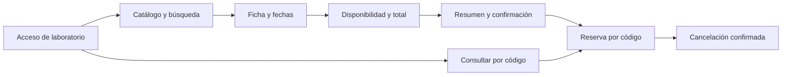

# Frontend del alquiler — especificación de F3-01

| Campo | Valor |
| --- | --- |
| Versión | 0.2 |
| Fecha | 8 de noviembre de 2026 |
| Estado | Implementado en la entrega 3 (PR #8); pruebas locales aprobadas; revisión visual pendiente |
| Hito | [Entrega 3](ENTREGA-3.md), primera etapa |
| Actor | Cliente de laboratorio vinculado a un conductor existente |
| Decisión técnica | [ADR-020](adr/ADR-020-frontend-alquiler.md) |

## 1. Objetivo y límites

Permitir el recorrido buscar → consultar disponibilidad → reservar → consultar/cancelar desde una interfaz web en español, consumiendo exclusivamente la API propia por el gateway. Las reglas de agenda, elegibilidad y precio siguen en Alquileres; la interfaz presenta resultados y valida formato para ayudar al usuario.

Esta primera etapa cubre catálogo, búsqueda, ficha, fechas, cotización, confirmación, consulta por código y cancelación previa al retiro. Se excluyen de F3-01 las pantallas de administración, retiro/devolución, mantenimiento, personal e integraciones; siguen previstas en otras etapas de la presentación. Tampoco se incorporan pagos, registro público, recuperación de contraseña ni una gestión de cuentas inexistente en el backend.

No existe `GET /v1/reservations` para listar reservas. Por ello se ofrece **Consultar reserva por código**, y no una pantalla que prometa un historial completo. No se agrega un endpoint para suplir esa ausencia en esta etapa.

## 2. Ingreso y contexto del cliente

El backend autentica aplicaciones mediante tokens opacos; no dispone de login con usuario/contraseña ni de un endpoint `me`. La pantalla de acceso de laboratorio solicita la credencial de rol `client` y el identificador de cliente entregados por el equipo. Comprueba el acceso con `GET /v1/customers/{id}` y utiliza el `id` devuelto como contexto de las solicitudes. El servidor mantiene la vinculación autorizada; cambiar el identificador en el formulario o en la URL no concede permisos.

El campo de credencial es de tipo contraseña. Se conserva solo en memoria durante la pestaña activa: nunca en URL, HTML generado, variables públicas de compilación, localStorage, sessionStorage, logs ni repositorio. Recargar requiere volver a entrar. Cerrar el acceso borra credencial, perfil y resultados visibles. No se entregan tokens `admin`, `service` o `gym` a esta interfaz; el formulario no infiere el rol decodificando el token ni acredita por sí mismo el rol de una credencial desconocida.

Una respuesta 401 no permite entrar; un 404 indica que ese perfil no está disponible para la credencial. Un 503 permite volver a intentar sin anunciar credenciales incorrectas. Un perfil inactivo puede consultar lo permitido por la API, pero la interfaz informa su condición; la decisión definitiva de reservar sigue siendo del backend. La licencia y los datos personales no se incluyen en URLs ni almacenamiento persistente del navegador.

El mecanismo es un acceso de laboratorio, no autenticación personal lista para producción. Una futura identidad de usuarios requiere diseño y contrato propios antes de ofrecer registro o contraseñas.

## 3. Pantallas y navegación

Las rutas siguientes son propuestas de navegación del navegador, no nuevos endpoints de negocio.

| Ruta web | Pantalla y contenido | Acción principal |
| --- | --- | --- |
| `/acceso` | Credencial e identificador de laboratorio; explicación breve del acceso | Entrar y consultar el perfil autorizado |
| `/autos` | Texto, filtros, orden, página y tarjetas con marca/modelo, categoría, transmisión, plazas y tarifa diaria | Buscar y abrir ficha |
| `/autos/:vehicleId` | Características, estado, fechas y resultado de disponibilidad con días y total | Consultar disponibilidad y revisar reserva |
| `/reservar` | Resumen del vehículo, cliente, período y total de la cotización vigente | Confirmar reserva |
| `/reservas/consultar` | Campo para código de reserva | Abrir una reserva propia |
| `/reservas/:reservationId` | Código, vehículo, fechas, precio congelado y estado actual | Consultar estado y cancelar si está reservada |

La navegación autenticada incluye catálogo, consulta por código y salida. Las URLs de búsqueda conservan filtros, orden y página para volver atrás; contienen solo esos parámetros. Abrir `/reservar` sin una cotización válida conduce a la selección de auto y fechas. Un enlace directo a una reserva requiere primero acceso y después consulta al servidor; no expone datos antes de validar permisos.

No hay imágenes de vehículos en el contrato actual. Las tarjetas usan información textual y un recurso neutro local; no se inventan fotos, promociones, descuentos o calificaciones.

## 4. Catálogo, búsqueda y ficha

Se utilizará `GET /v1/vehicles/search` para texto y filtros indexados. Controles: `q`, `brand`, `category`, `transmission`, `seats`, `sort`, `page` y `pageSize`; página inicial 1, tamaño 20 y máximo 100. Marca y categoría se envían como texto exacto, con espacios exteriores recortados; no se presentan opciones de catálogo completo a partir de una única página. Transmisión admite `manual` y `automatic`, plazas por igualdad de 1 a 9 u omisión, y orden `price_asc`/`price_desc`. Se respetan las longitudes máximas del contrato.

Cambiar texto, filtro u orden vuelve a página 1; el botón Buscar aplica los criterios, evitando solicitudes por cada tecla. La pantalla diferencia carga, página vacía y servicio de búsqueda no disponible. Si Solr falla, no se anuncia «sin autos». Puede ofrecerse **Ver catálogo sin búsqueda** mediante `GET /v1/vehicles`, retirando `q` y comunicando que se dejó de aplicar el texto; no se realiza un fallback silencioso.

La ficha se obtiene por `GET /v1/vehicles/{id}`. El cliente nunca usa `includeInactive=true`. Si una ficha llega inactiva por enlace directo, se informa y no se ofrece confirmar. La tarifa de ficha/búsqueda es orientativa; la disponibilidad obtiene el total a presentar antes de reservar. La consulta no bloquea el vehículo ni garantiza una confirmación posterior.

Las solicitudes GET de una vista se cancelan o descartan al cambiar parámetros. Una respuesta anterior no puede reemplazar el resultado de filtros, fechas o vehículo más recientes.

## 5. Fechas, importes y cotización

Las fechas son cadenas calendario `YYYY-MM-DD` en `America/Buenos_Aires`; inicio incluido y fin excluido. Inicio desde hoy, fin posterior y duración de 1 a 30 días. No convertir fechas seleccionadas mediante una conversión UTC que pueda cambiar el día; la comparación de días calendario no depende de la zona local del dispositivo. El reloj del servidor es la autoridad y sus rechazos se muestran aunque la validación del navegador haya pasado.

Al cambiar vehículo o cualquiera de las fechas se invalida la cotización previa y se deshabilita confirmar hasta consultar nuevamente. Solo un resultado vigente `available=true` habilita revisar la reserva. `available=false` se presenta como indisponibilidad de negocio; un error HTTP o de red se muestra por separado.

Los campos `dailyRateMinor`, `totalMinor` y `expectedTotalMinor` son enteros en centavos de ARS. Se formatean para lectura con moneda, sin usar aritmética de coma flotante para calcular el total enviado. El cliente toma el total de la respuesta de Alquileres. Si un entero recibido excede la representación segura de JavaScript, se informa un error de datos y se bloquea confirmar en lugar de redondear el importe.

El resumen muestra marca/modelo, inicio, devolución, cantidad de días, tarifa diaria y total, además del perfil autorizado. No hay cargo ni pasarela de pago. El botón se denomina **Confirmar reserva**.

## 6. Contratos consumidos

Todos los endpoints pasan por el gateway y usan la credencial `client` con `Authorization: Bearer ...`. Los contratos de referencia son [Clientes](contracts/customers-openapi.json), [Flota](contracts/fleet-openapi.json) y [Alquileres](contracts/rentals-openapi.json). [API](API.md) explica sus permisos y limitaciones.

| Método y ruta | Uso en F3-01 | Campos o condiciones relevantes |
| --- | --- | --- |
| `GET /v1/customers/{id}` | Validar acceso al perfil | `id`, `name`, `active`, `licenseValidUntil`; propiedad aplicada por servidor |
| `GET /v1/vehicles/search` | Buscar activos | `q`, filtros, orden y paginación |
| `GET /v1/vehicles` | Catálogo explícito sin texto cuando se ofrece la alternativa | No atribuir filtrado por `q` a MongoDB |
| `GET /v1/vehicles/{id}` | Ficha | Verificar actividad; tarifa orientativa |
| `GET /v1/availability` | Disponibilidad y total | `vehicleId`, `startsOn`, `endsOn`, cada uno una sola vez |
| `POST /v1/reservations` | Crear o recuperar la misma operación | JSON de cinco campos e `Idempotency-Key` |
| `GET /v1/reservations/{id}` | Estado actual y precio congelado | Consulta propia; 404 puede ocultar una reserva ajena |
| `DELETE /v1/reservations/{id}` | Cancelar antes del retiro | Sin cuerpo; repetición segura según contrato |

Cuerpo de creación: `vehicleId`, `customerId`, `startsOn`, `endsOn` y `expectedTotalMinor`, con `Content-Type: application/json`. El `customerId` proviene del perfil validado, no de un campo editable del resumen. No se consume `/v1/vehicles/{id}/quote`: la API no lo permite al rol `client`.

## 7. Confirmación e idempotencia

Al confirmar se crea una clave UUID y se congela el cuerpo exacto de la solicitud. Se deshabilita el botón hasta recibir resultado. La clave y ese cuerpo se guardan como una única operación pendiente en sessionStorage, bajo versión de formato e identificador de cliente; sin token, nombre ni licencia. Se guardan **antes** de enviar. Si no se puede conservar la operación, no se envía y se informa el problema. Dos pulsaciones no crean claves distintas.

Una respuesta 201 aporta el código de reserva. Se elimina la operación pendiente y se consulta `GET /v1/reservations/{id}` para mostrar el estado actual; una recuperación idempotente puede devolver la respuesta original de creación incluso si la reserva cambió después. Un fallo de esa lectura no autoriza volver a crear: se conserva y muestra el código confirmado.

Un timeout, desconexión, JSON ilegible o 5xx después del envío deja **resultado pendiente de confirmar**. No se muestra fracaso definitivo, no se crea otra clave y no se edita el cuerpo pendiente. La acción explícita **Recuperar resultado** repite el mismo POST con clave/cuerpo originales; no hay reintento automático de escrituras. Recargar permite recuperar la operación después de volver a validar el mismo perfil; no la envía por sí sola. No se comparte esa recuperación entre clientes. Cambiar de sesión no borra una operación incierta ni la presenta a otra identidad.

Ante un rechazo de negocio definitivo se resuelve la operación pendiente y se permite volver al flujo correspondiente. Si hubo cambio de precio, se exige una nueva cotización y aceptación del importe; esa nueva solicitud recibe otra clave. `IDEMPOTENCY_KEY_REUSED` bloquea el envío y pide revisar/recuperar la operación original, sin sustituirla automáticamente.

La pérdida manual de almacenamiento o el cierre de la pestaña puede impedir recuperar una creación cuyo código nunca llegó: esa limitación se explica en el estado de resultado incierto. No se ofrece «empezar otra reserva» como solución a una escritura todavía desconocida.

## 8. Consulta y cancelación

El usuario introduce un código y la UI consulta su estado al servidor. Un código ajeno o inexistente se informa de la misma manera, sin revelar propietario. Se ofrece copiar el código tras la creación; no se presentan códigos guardados en el navegador como un historial completo del servidor.

| Estado API | Etiqueta | Acción del cliente |
| --- | --- | --- |
| `RESERVED` | Reservada | Cancelar con confirmación explícita |
| `ACTIVE` | En curso | Consultar; sin cancelación |
| `COMPLETED` | Finalizada | Consultar |
| `CANCELLED` | Cancelada | Consultar |

El diálogo de cancelación muestra código y fechas y ofrece mantener o cancelar. El éxito se muestra solo tras respuesta del servidor. Ante timeout se consulta el estado actual antes de ofrecer repetir DELETE; no se transforma una reserva desconocida en cancelada. Un conflicto de estado actualiza la vista. Alcanzar la fecha de devolución no finaliza por sí solo una reserva `ACTIVE`.

## 9. Estados de error y mensajes

Se decide por HTTP y `code`; `message` no es un contrato para lógica de UI. El cliente HTTP debe tolerar respuestas vacías o texto plano inesperadas. El mensaje visible usa lenguaje del negocio y ofrece copiar `X-Request-ID` cuando esté disponible, sin volcar tokens, cuerpos ni trazas internas.

| Situación | Comportamiento visible |
| --- | --- |
| 400 / `INVALID_INPUT` | Señalar datos inválidos, conservar campos para corregir |
| 401 | Quitar credencial de memoria y solicitar nuevo acceso; conservar la operación incierta para el mismo perfil |
| 403 | Informar falta de permiso; no resolverlo usando otra credencial privilegiada |
| 404 de reserva/perfil | Recurso no disponible para este acceso; sin revelar si pertenece a otra persona |
| 409 / `VEHICLE_UNAVAILABLE` | Informar conflicto de disponibilidad y volver a elegir fechas/auto |
| 409 / `PRICE_CHANGED` | Invalidar cotización y volver a consultar; pedir aceptación del nuevo total |
| 409 / `IDEMPOTENCY_KEY_REUSED` | Bloquear nueva creación y conservar información para revisión |
| 409 / `INVALID_STATE` | Consultar estado actual y actualizar acciones |
| 422 / `CUSTOMER_NOT_ELIGIBLE` | Informar que el conductor no está habilitado; sin simular una corrección local |
| 503 / `SEARCH_UNAVAILABLE` | Búsqueda temporalmente no disponible; ofrecer reintento o catálogo explícito |
| 503 / indisponibilidad o red en GET | Permitir reintento manual, sin mostrar un resultado de negocio negativo |
| 5xx, red o respuesta inválida tras POST | Mantener operación incierta y recuperación con la misma clave |

Presupuesto inicial propuesto por solicitud de UI: 10 s, superior al timeout interno del gateway, configurable en el cliente HTTP. Cancelar la espera del navegador no revierte la transacción del servidor. No se reintentan POST por interceptores ni por bibliotecas de consultas.

## 10. Presentación y accesibilidad

Diseño adaptable desde 360 px hasta escritorio, sin desplazamiento horizontal del recorrido principal. Tarjetas en una columna en móvil y grilla en escritorio; resumen con total y acción principal visibles. Tipografía legible, contraste suficiente, foco visible, etiquetas asociadas, mensajes vinculados a campos y navegación por teclado. El estado nunca depende solo del color.

Las cargas usan indicadores con texto y los resultados relevantes se anuncian a tecnologías de asistencia. El diálogo de cancelación administra foco y permite salir con teclado. Al cambiar de pantalla se actualiza título/foco. Los botones de escritura muestran la acción en curso y no admiten envíos duplicados. El usuario puede revisar el total y las fechas antes de confirmar.

## 11. Criterios de aceptación y trazabilidad

Los identificadores FE-A son tareas de interfaz de esta etapa; no reemplazan ni renumeran RF/HU del proyecto.

| ID | Historia / requisito base | Criterio verificable |
| --- | --- | --- |
| FE-A01 | HU-03/HU-18; RF-18 | Dada la credencial de laboratorio, entrar solo después de leer el perfil autorizado; 401/404 no muestran datos y recargar no restaura el token |
| FE-A02 | HU-02; RF-02/RF-21 | Aplicar texto/filtros/orden/página por búsqueda real; una respuesta vieja no reemplaza una búsqueda posterior |
| FE-A03 | HU-01/HU-04; RF-01/RF-04 | Abrir ficha, validar días calendario y consultar disponibilidad; modificar fechas invalida el total previo |
| FE-A04 | HU-05; RF-05 | Mostrar total de Alquileres y crear una sola reserva aun con doble clic; mostrar código real y consultar estado actual |
| FE-A05 | HU-05; RF-05/RNF-01 | Simular pérdida de respuesta después de crear; recuperar con mismo cuerpo/clave, incluso tras recargar y entrar, sin segunda reserva |
| FE-A06 | HU-05; RF-05 | Simular precio cambiado o reserva competidora; no mostrar éxito y exigir nueva decisión del usuario |
| FE-A07 | HU-05/HU-18; RF-05/RF-18 | Consultar por código; el servidor deniega una reserva ajena sin revelar datos |
| FE-A08 | HU-06; RF-06 | Cancelar RESERVED con confirmación; repetir no duplica efectos; ACTIVE/COMPLETED no muestran cancelación |
| FE-A09 | HU-20/HU-27 | Distinguir sin resultados, indisponibilidad y escritura incierta, conservando referencia de solicitud sin secretos |
| FE-A10 | RNF transversales de usabilidad | Completar el recorrido con teclado y en 360 px; errores, foco y total comprensibles |

## 12. Orden de implementación y validación futura

1. Base de React/TypeScript/Vite, rutas, estilos, cliente HTTP y proxy del mismo origen; fijar versiones y lockfile.
2. Acceso de laboratorio y catálogo/búsqueda con estados de carga, vacío y error.
3. Ficha, fechas, disponibilidad y resumen con reglas de invalidación.
4. Creación idempotente, resultado incierto y recuperación después de recarga.
5. Consulta por código y cancelación; verificación de permisos y estados.
6. Recorrido real en navegador, accesibilidad móvil/teclado y evidencia de aceptación.

Las pruebas de componentes cubren cambios de cotización, datos fuera de orden y escrituras inciertas, usando respuestas controladas identificadas como tales. La aceptación de integración exige API real: perfil habilitado, vehículo activo, fechas vigentes, confirmación, GET y cancelación. El ensayo de pérdida de respuesta debe verificar en el backend una única reserva; un mock por sí solo no acredita persistencia.

El build reproducible, las pruebas de componentes y el recorrido React contra API real están registrados en [EVIDENCIA-FRONTEND](EVIDENCIA-FRONTEND.md). La revisión visual móvil/teclado en navegador sigue pendiente por bloqueo de la herramienta. No se declara el cierre completo de FE-A10 ni del frontend final de presentación.
