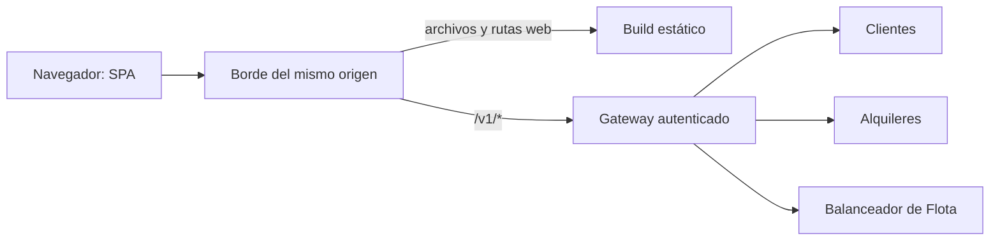

# ADR-020 — Frontend del alquiler

| Campo | Valor |
| --- | --- |
| Fecha | 8 de noviembre de 2026 |
| Estado | Implementado en la entrega 3 (PR #8); revisión en navegador completada el 9 de noviembre de 2026; revisión del equipo y publicación pendientes |
| Alcance | F3-01 de [entrega 3](../ENTREGA-3.md) |
| Complementa | D2: presentación y límites; D5: consumo HTTP; D11: correlación |
| Sustituye | Ningún ADR del backend |

## 1. Contexto

Car Cruds dispone de API propia en Go, contratos OpenAPI y reglas transaccionales en los servicios. Falta la interfaz web del alquiler exigida para la presentación grupal. El frontend debe consumir la API existente y presentar su consistencia y fallas sin duplicar la autoridad del dominio. Swagger es documentación de lectura y no cubre ese recorrido.

La referencia académica es [el enunciado](../../Enunciado%20TP%20Final.md). Se consultaron `teoria/06-gateway-lb-discovery.md`, `teoria/08-estilos-arquitectura-backend.md` y `practica/README.md` dentro de `clases.zip`: entrada estable por gateway, autorización en el servicio propietario y separación de reglas y adaptadores. La elección de framework web es del equipo, no una imposición de la cátedra.

## 2. Decisión propuesta

Usar **React con TypeScript y Vite**, React Router para navegación, CSS propio adaptable y un adaptador HTTP sobre `fetch`. El primer incremento es una SPA que utiliza el backend Go; no requiere SSR ni un segundo servidor con reglas de negocio. No se incorpora Redux ni una biblioteca de reintentos automáticos en esta etapa. Estado de pantalla local, contexto de acceso en memoria y filtros/página en la URL son suficientes para el alcance inicial.

La documentación oficial de [React sobre una aplicación desde cero](https://react.dev/learn/build-a-react-app-from-scratch) identifica Vite y la plantilla React/TypeScript, y advierte que navegación y acceso a datos requieren decisiones adicionales. [Vite](https://vite.dev/guide/) documenta el desarrollo y build estático. La elección acepta ese trabajo adicional para integrar una interfaz acotada a una API ya existente; no presume ventajas medidas ni una recomendación universal de SPA.

Versiones implementadas y fijadas en manifiesto/lockfile: Node 24.11.1, React 19.3.1, Vite 8.3.6, React Router 7.18.5 y TypeScript 7.0.2. jsdom 29.1.1 es compatible con ese Node; Vitest 5.1.0 verifica componentes. Fontsource sirve las tipografías localmente, sin requerir Google Fonts. Build local y Docker aprobados; ver [evidencia](../EVIDENCIA-FRONTEND.md).

## 3. Organización y dependencias

Estructura implementada bajo `frontend/src/`: `App.tsx` reúne rutas, contexto de acceso y pantallas de este incremento; `api.ts` delimita transporte/errores; `domain.ts` contiene tipos, fechas, importes y operación pendiente; `CarArt.tsx` y `styles.css` contienen presentación. Las pruebas de comportamiento y de API real viven en archivos separados. La división por carpetas de funcionalidades queda como refactor al ampliar administración y personal, sin presentar directorios inexistentes.

Las páginas coordinan acciones de UI; el adaptador HTTP centraliza encabezados, timeout, parseo tolerante y correlación. La presentación adapta los DTO a etiquetas y formatos. Las reglas de precio autoritativo, propiedad, concurrencia e idempotencia durable permanecen en los servicios. La validación local es ayuda al usuario y no reemplaza el rechazo del servidor.

## 4. Entrada única y distribución prevista

El navegador solicita rutas relativas `/v1/*`. En desarrollo, el proxy de Vite reenviará esas rutas únicamente al gateway local. En publicación, el borde HTTP servirá archivos estáticos y enviará `/v1/*` al gateway; el fallback de navegación SPA no debe interceptar errores de API. Las rutas `/internal/*` continuarán fuera del acceso público. La autenticación sigue aplicándose a la API; cargar recursos estáticos no concede acceso a datos.

Vite/proxy y el servidor estático NGINX de `compose.frontend.yaml` ya implementan esta topología local, con API del mismo origen. El Caddyfile público actual todavía reenvía todo al gateway: su adaptación y publicación HTTPS siguen pendientes. No se modificó el despliegue público por agregar la entrada local. No se abre CORS global ni se conecta el navegador directamente a microservicios, almacenes, gimnasio u hospital.

## 5. Acceso y recuperación

Se utiliza el acceso de laboratorio del backend, con credencial `client` en memoria y perfil validado por GET. No se inventa login personal ni se incrustan credenciales privilegiadas en el bundle. El ID del cliente no es autorización y se sigue comprobando en el servicio dueño del recurso. Los límites de uso público de este acceso quedan explícitos en [la especificación](../FRONTEND-ALQUILER.md).

Los comandos POST no se reintentan automáticamente. Una reserva incierta mantiene la clave y el cuerpo originales en un registro de operación de la pestaña, sin token ni perfil personal. Recuperar es una acción explícita y verifica el mismo contexto de cliente. Toda cotización caduca al cambiar vehículo o fechas; un cambio de precio exige aceptación del usuario. El almacenamiento local nunca se considera inventario ni historial autoritativo.

## 6. Alternativas y consecuencias

| Alternativa | Evaluación |
| --- | --- |
| HTML y JavaScript sin framework | Menor infraestructura inicial, pero requiere organizar manualmente navegación y estados de formularios/solicitudes; no elegida para el recorrido previsto |
| Framework con servidor y SSR | Útil si se requieren renderizado servidor y descubrimiento público; agrega otra capa de ejecución sin necesidad identificada en este incremento |
| React/TypeScript/Vite | Seleccionada como propuesta por separar UI de una API existente; requiere resolver rutas, estados de red, accesibilidad y publicación estática |

La SPA necesita manejo de enlaces directos y fallback de rutas web, build y dependencias de Node. La ausencia de listado de reservas limita el producto a consulta por código; la ausencia de login personal limita el ingreso al laboratorio. No se crean endpoints para ocultar estas limitaciones. Una identidad de usuarios futura exige una nueva decisión y contrato.

## 7. Verificación pendiente

Revisar contratos y ejecutar los criterios FE-A01 a FE-A10 al implementar: build reproducible, tipos y pruebas de comportamiento, recorrido contra API real, recuperación de escritura incierta, permisos y accesibilidad. Registrar resultados nuevos y revisión probada. La aprobación de esta propuesta documental no acredita que la interfaz ya exista ni que la presentación grupal esté completa.
